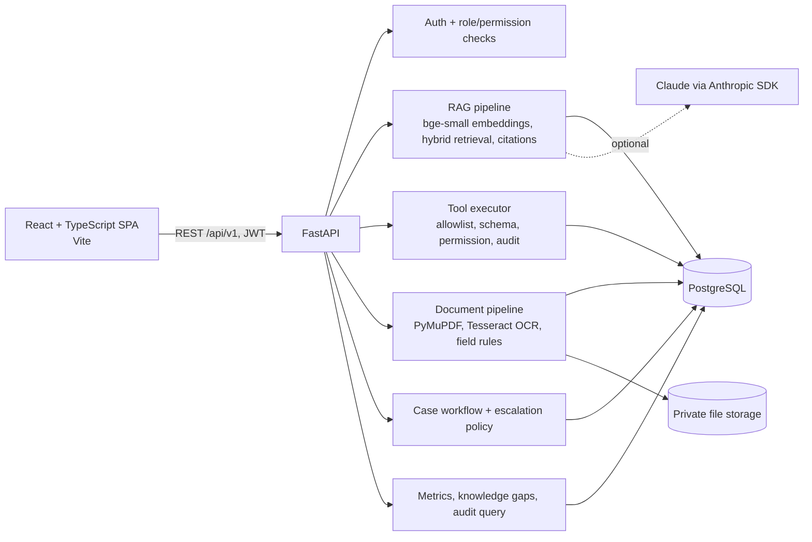

# Intelligent Healthcare Support Agent (IHSA)

An AI-powered healthcare-insurance information and administrative support prototype, built as an **independent case study associated with an Evernorth internship**.

> **Synthetic prototype.** All plans, members, claims, documents and requirement sets are fictional. IHSA is **not** an Evernorth product, uses no Evernorth data or systems, and makes **no** coverage, approval, denial or medical-necessity decisions. Metrics shown by the app describe the prototype's own synthetic activity only.

## What it does

| Capability | What the user sees | Phase |
|---|---|---|
| Secure accounts and roles | Sign-in with JWT, four roles (member, provider, support agent, admin), and a role-aware interface. The backend enforces every permission | 2–3 |
| Claims and benefits | A member's own synthetic claims and plan benefits; providers can look up any plan | 2–3 |
| Source-grounded assistant (RAG) | Answers come from a synthetic knowledge base, with validated citations. It says "I couldn't find this" instead of guessing, and flags conflicting sources | 4 |
| Controlled tool calling | The assistant can look up claims, benefits and documentation requirements through an allowlisted, permission-checked executor, and can *propose* a support case that is created only after the user confirms | 5 |
| Document AI | Upload a PDF, PNG or JPEG. The text layer is extracted, with OCR for scanned pages; fields are extracted and validated, each with its source page | 6 |
| Prior authorization readiness | A deterministic checklist (`SATISFIED` / `MISSING` / `UNREADABLE` / `NEEDS_MANUAL_REVIEW`) against fictional requirement sets, with evidence, sources and a reviewer summary. It is **not an approval** | 6 |
| Escalation and human review | Support cases follow a validated lifecycle. Agents have a queue, assignment, notes and resolution, all version-checked against concurrent edits and audited | 7 |
| Audit and admin dashboard | A read-only audit log; metrics and knowledge-gap reports computed from real records, never estimates | 7 |
| Feedback and retention | Members and staff rate answers (👍/👎); a retention job removes expired conversations, documents and tokens | 8 |
| Testing, security, deployment | System-wide tests, security and load checks, Dockerfiles, Compose and CI | 8 |

## Architecture



| Part | Technology |
|---|---|
| Backend | Python 3.12, FastAPI, Pydantic v2, SQLAlchemy 2, Alembic, PostgreSQL 18, argon2id, PyJWT |
| AI | fastembed (`BAAI/bge-small-en-v1.5`, CPU), hybrid vector and full-text retrieval; an LLM-free extractive answerer by default, with optional Claude (`LLM_PROVIDER=anthropic`) |
| Documents | PyMuPDF, Pillow, Tesseract CLI (optional) |
| Frontend | React 18, TypeScript, Vite, React Router, Vitest + Testing Library |

## Repository layout

```
backend/    FastAPI app, migrations, seed and evaluation scripts, tests   → backend/README.md
frontend/   React application and tests                                    → frontend/README.md
docs/       Design and phase documentation (phase-1 … phase-8)
compose.yaml, .github/workflows/ci.yml   Container and CI definitions (see docs/phase-8/deployment-guide.md)
```

## Quick start (Windows PowerShell; local development)

Prerequisites: Python 3.12, Node.js 20+, a PostgreSQL 18 installation, and optionally Tesseract OCR.

```powershell
# 1. Backend
cd backend
python -m venv .venv; .\.venv\Scripts\pip install -r requirements.txt
Copy-Item .env.example .env        # set JWT_SECRET and SEED_USER_PASSWORD
.\scripts\local_postgres.ps1 init  # private localhost cluster (first time); later: start
.\.venv\Scripts\alembic upgrade head
.\.venv\Scripts\python -m scripts.seed_demo_data
.\.venv\Scripts\python -m scripts.ingest_knowledge_base
.\.venv\Scripts\uvicorn app.main:app --port 8000

# 2. Frontend (new terminal)
cd frontend
npm ci; Copy-Item .env.example .env.local
npm run dev                        # open http://localhost:5173
```

Full setup, environment variables and troubleshooting are in [backend/README.md](backend/README.md) and [frontend/README.md](frontend/README.md).

### Demo accounts (synthetic)

All use the password you set as `SEED_USER_PASSWORD` in `backend/.env`.

| Role | Email | Try |
|---|---|---|
| Member | `priya.member@example.test` | "What is the status of my claim SYN-CLM-2026-000101?", "Does my plan cover acupuncture?" → Ask a support agent |
| Provider | `jordan.provider@example.test` | Documents → upload `backend/data/samples/documents/*.pdf` → Analyze → PA readiness |
| Support agent | `sam.agent@example.test` | Case queue → Assign to me → Start → Resolve |
| Admin | `alex.admin@example.test` | Admin dashboard: metrics, knowledge gaps, audit log, all cases |

## Tests and evaluation

```powershell
cd backend;  .\.venv\Scripts\python -m pytest -ra    # 456 tests (needs the local PostgreSQL)
cd frontend; npm run lint; npx tsc --noEmit; npx vitest run   # 104 tests
cd backend;  .\.venv\Scripts\python -m scripts.evaluate_rag         # RAG evaluation (131 items)
cd backend;  .\.venv\Scripts\python -m scripts.evaluate_documents   # document AI evaluation
```

Results recorded on 2026-10-27 (Phase 8): 456/456 backend tests (95% coverage), 104/104 frontend tests, pip-audit and npm audit clean, secret scan 0 findings. RAG behavior accuracy is 87.8% (recall@5 100%), and document extraction and checklist correctness are 100% on the synthetic text-layer corpus. A bounded local load test (10 and 50 users) had 0% errors. Details and caveats: [docs/phase-8/test-report.md](docs/phase-8/test-report.md).

## Documentation

| Phase | Documents |
|---|---|
| 1 — Requirements and design | [docs/phase-1/](docs/phase-1/README.md): requirements, roles, workflows, architecture, database, API contract, AI design, UI, security, traceability, risks |
| 2 — Backend and database | [backend/README.md](backend/README.md) |
| 3 — Frontend | [docs/phase-3/](docs/phase-3/), [frontend/README.md](frontend/README.md) |
| 4 — RAG assistant | [docs/phase-4/](docs/phase-4/): implementation, knowledge-base guide, evaluation report |
| 5 — Tool calling | [docs/phase-5/](docs/phase-5/): tool integration, API contracts, testing report |
| 6 — Document AI and readiness | [docs/phase-6/](docs/phase-6/): architecture, processing guide, evaluation report |
| 7 — Escalation, audit, dashboard | [docs/phase-7/](docs/phase-7/): case management, audit architecture, metric dictionary, testing report |
| 8 — Verification and deployment | [docs/phase-8/](docs/phase-8/): requirements verification, test report, AI evaluation, security report, deployment guide, final demo guide |

## Known limitations

- **OCR is unverified:** Tesseract isn't bundled, so scanned pages are reported as unreadable until it is installed and configured.
- **Claude features are unverified live:** generation, tool use and LLM-assisted extraction are tested with mocked clients only. The default mode is LLM-free.
- **No malware scanning** of uploads, and the audit log is not tamper-evident against a database superuser.
- **Docker and CI are unexecuted here:** the Dockerfiles, `compose.yaml` and the CI workflow are written and validated, but Docker isn't installed in this environment and the workflow hasn't run on GitHub yet.
- **Not production-ready:** single-process background jobs, a local file store, a local database, no mypy type checking. See [docs/phase-8/requirements-verification.md](docs/phase-8/requirements-verification.md) for the full Pass / Partial / Blocked list.

## Responsible use

IHSA is a learning prototype. Do not upload real personal or health information. Readiness checklists review documentation completeness only. They are not authorization approvals, denials, medical-necessity determinations or guarantees of coverage, and every decision that requires judgment belongs to an authorized human reviewer.
