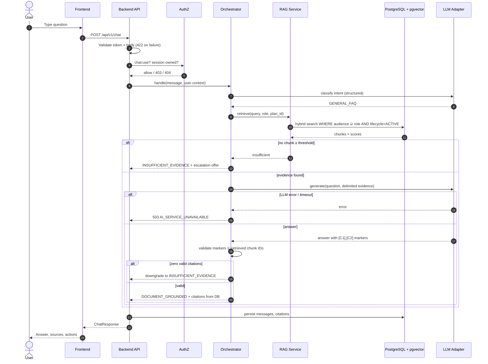
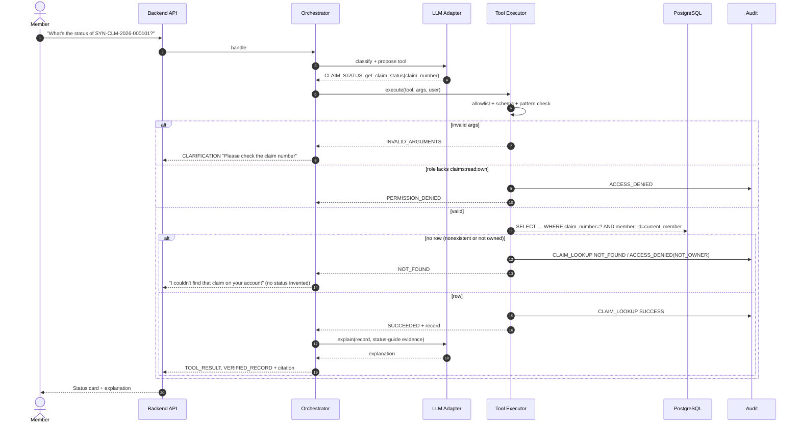
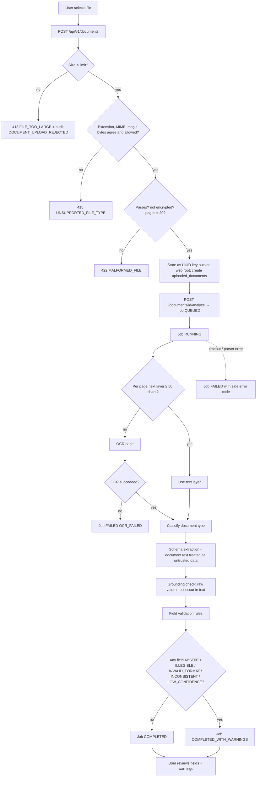
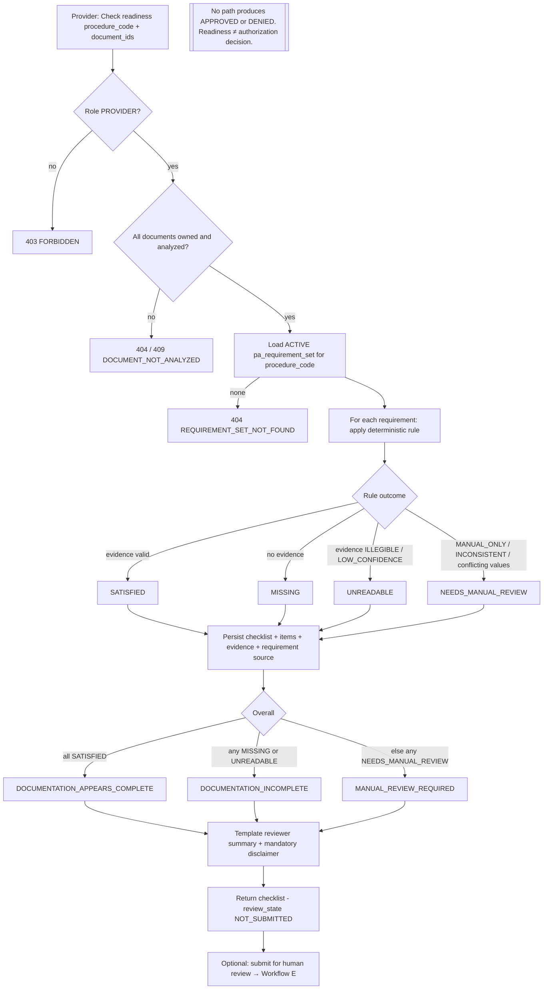
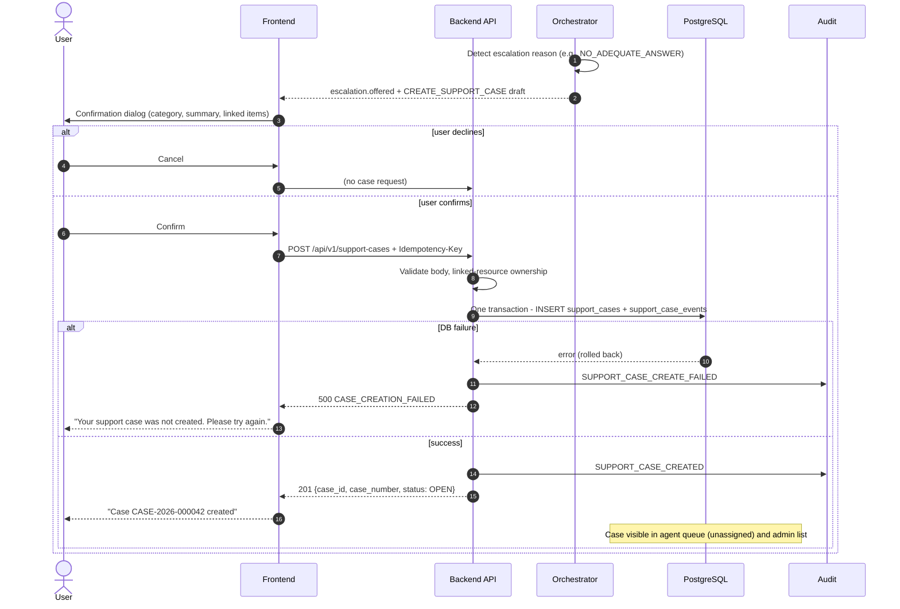
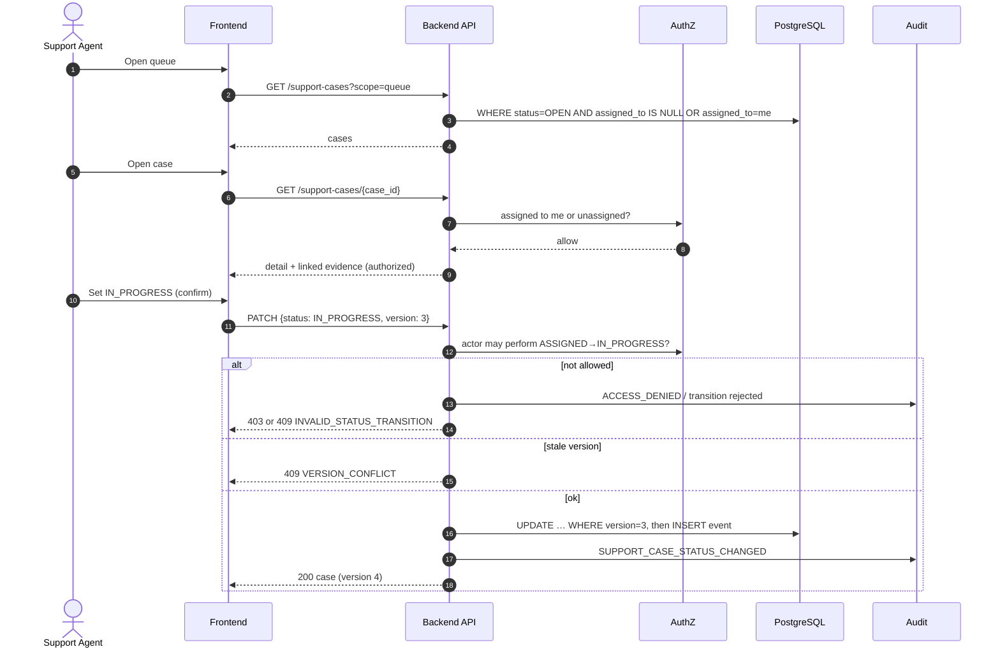
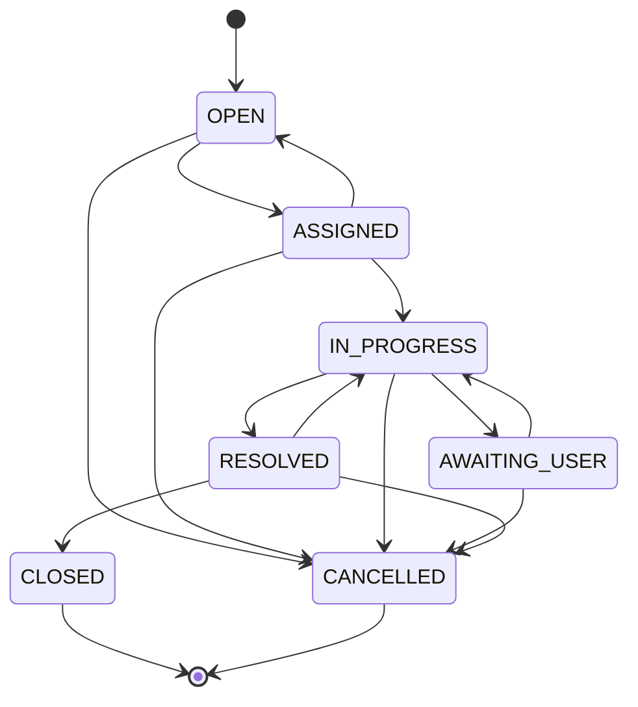

# 02 — Use Cases and Workflow Design

Terminology, roles, statuses and IDs follow docs 01, 03, 05 and 06. §3 of this document is the **single authoritative definition of all status enumerations**.

---

## 1. Primary Use Cases

Common precondition for every use case: the actor is authenticated (FR-001) and has an `ACTIVE` account.

### UC-01 — Ask a healthcare administrative question
| Field | Detail |
|---|---|
| Primary actor | MEMBER, PROVIDER (also SUPPORT_AGENT, ADMIN) |
| Secondary systems | Orchestrator, LLM adapter, RAG service, PostgreSQL |
| Preconditions | Role has `chat:use` |
| Trigger | User submits a message in the chat composer |
| Main success path | 1. Frontend sends `POST /api/v1/chat` with message (and `session_id` if continuing). 2. Backend validates input and session ownership. 3. User message persisted. 4. Intent classified (FR-005). 5. Request routed (UC-02, UC-04, UC-05, UC-06, UC-10). 6. Assistant message persisted with intent, evidence status, latency. 7. Response rendered. |
| Alternative paths | A1: No `session_id` → new session created, title = first 60 chars of message. A2: Ambiguous → clarification question (FR-006). A3: Unsupported (e.g., diagnosis) → `UNSUPPORTED_REQUEST` with explanation and escalation offer (`OUT_OF_SCOPE`). |
| Error paths | E1: Empty or >4,000 chars → 422 `VALIDATION_ERROR`. E2: Foreign session → 404. E3: LLM unavailable → 503 `AI_SERVICE_UNAVAILABLE`; user message kept, no assistant answer stored as successful. E4: Rate limit → 429. |
| Permissions | `chat:use`; session ownership |
| Data read/modified | Creates/reads `conversation_sessions`, `conversation_messages` |
| Result | Assistant message with answer type, evidence status, citations, actions |
| Related FRs | FR-004, FR-005, FR-006, FR-007 |
| Acceptance tests | AT-007, AT-008, AT-009, AT-010, AT-011 |

### UC-02 — Retrieve a source-grounded answer (RAG)
| Field | Detail |
|---|---|
| Primary actor | MEMBER, PROVIDER |
| Secondary systems | RAG service, embedding model, pgvector, LLM adapter |
| Preconditions | Intent ∈ `GENERAL_FAQ`, `BENEFITS_INFO` (policy question), `REQUIRED_DOCUMENTS` (explanatory) |
| Trigger | Routed from UC-01 |
| Main success path | 1. Build retrieval query from message + recent context. 2. Hybrid search with permission filters (audience, plan scope, `ACTIVE`). 3. Keep chunks with score ≥ threshold. 4. Prompt LLM with delimited evidence. 5. Validate citation markers (FR-011). 6. Attach citation records built from stored chunk data. 7. Return `DOCUMENT_GROUNDED` / `SUPPORTED`. |
| Alternative paths | A1: Retrieved active chunks conflict → `CONFLICTING` with both sources (FR-013). A2: Some markers invalid → removed, `citation_check = PARTIALLY_REMOVED`. |
| Error paths | E1: No chunk above threshold → UC-03. E2: All markers invalid → downgraded to UC-03 (`ALL_INVALID_DOWNGRADED`). E3: Embedding/LLM failure → 503. |
| Permissions | `knowledge:read` filtered by audience |
| Data read/modified | Reads `knowledge_documents`, `document_chunks`; writes `message_citations` |
| Result | Answer + citations (title, version, effective date, section, page, excerpt) |
| Related FRs | FR-009, FR-010, FR-011, FR-013 |
| Acceptance tests | AT-014, AT-015, AT-016, AT-018 |

### UC-03 — Receive an insufficient-evidence response
| Field | Detail |
|---|---|
| Primary actor | Any chat user |
| Preconditions | UC-02 found no adequate evidence or citations failed validation |
| Trigger | Retrieval/validation outcome |
| Main success path | 1. Backend selects standard insufficient-evidence template. 2. No policy facts generated. 3. `escalation.offered = true`, reason `NO_ADEQUATE_ANSWER`, prefilled case draft. 4. Message flagged for knowledge-gap analysis (FR-033). |
| Alternative paths | A1: User accepts → UC-10. A2: User rephrases → UC-01. |
| Error paths | None beyond UC-01 errors |
| Permissions | `chat:use` |
| Data read/modified | Writes assistant message with `evidence_status = INSUFFICIENT` |
| Result | "I couldn't find this in the documents available to me…" + escalation option |
| Related FRs | FR-012, FR-026, FR-033 |
| Acceptance tests | AT-017, AT-043 |

### UC-04 — Check a synthetic claim status
| Field | Detail |
|---|---|
| Primary actor | MEMBER |
| Secondary systems | Tool executor, PostgreSQL, RAG (status explanation) |
| Preconditions | Member has a linked `members` record |
| Trigger | Chat intent `CLAIM_STATUS`, or Claims screen |
| Main success path | 1. Extract claim number (or ask for it; or list own recent claims). 2. LLM proposes `get_claim_status(claim_number)`. 3. Backend validates schema and pattern. 4. Backend queries claim with `member_id = current member`. 5. Tool returns `SUCCEEDED` with record. 6. Assistant explains status; status meaning cited from claim-status guide. |
| Alternative paths | A1: No claim number → clarification listing the member's own recent claim numbers. A2: Via UI → `GET /api/v1/claims/{claim_number}`. |
| Error paths | E1: Claim doesn't exist or belongs to someone else → `NOT_FOUND`, "I couldn't find a claim with that number on your account." Audit `ACCESS_DENIED` for not-owned. E2: Malformed number → `INVALID_ARGUMENTS` → clarification. E3: DB error → `EXECUTION_ERROR`, escalation offered (`TOOL_FAILURE`). |
| Permissions | `claims:read:own` |
| Data read/modified | Reads `claims`, `members`; writes `tool_invocations`, `audit_logs` |
| Result | Status, dates and explanation, labeled "From your claim record" |
| Related FRs | FR-014, FR-017, FR-003 |
| Acceptance tests | AT-005, AT-019, AT-020, AT-024, AT-026 |

### UC-05 — Retrieve synthetic plan-benefit information
| Field | Detail |
|---|---|
| Primary actor | MEMBER (own plan); PROVIDER (any active plan) |
| Preconditions | Plan exists and is active |
| Trigger | Chat intent `BENEFITS_INFO` asking about specific benefit terms, or Benefits screen |
| Main success path | 1. Determine plan (member: own plan implicitly; provider: must name `plan_code`). 2. `get_plan_benefits(plan_code, benefit_category?)`. 3. Backend checks scope. 4. Return benefit entries with source document reference. 5. Assistant summarizes, labeling values "From plan record" and explanations with citations. |
| Alternative paths | A1: Provider omits plan → clarification. |
| Error paths | E1: Unknown plan / member requests other plan → `NOT_FOUND`. E2: Category not present → "This plan record has no entry for that service", escalation offered. |
| Permissions | `benefits:read:own` (member), `benefits:read:any` (provider, agent, admin) |
| Data read/modified | Reads `plans`, `plan_benefits` |
| Result | Benefit table + source |
| Related FRs | FR-015, FR-017 |
| Acceptance tests | AT-021, AT-022 |

### UC-06 — Find relevant document requirements
| Field | Detail |
|---|---|
| Primary actor | PROVIDER (also MEMBER) |
| Trigger | Intent `REQUIRED_DOCUMENTS`, or Readiness screen requirement preview |
| Main success path | 1. Identify procedure/workflow code (map from name via requirement-set aliases, or ask). 2. `get_required_documents(procedure_code)`. 3. Return active requirement set: each requirement, mandatory flag, and source chunk citation. 4. Proposed action `START_READINESS_CHECK` (providers) or `UPLOAD_DOCUMENT`. |
| Alternative paths | A1: Multiple matching sets → clarification with choices. |
| Error paths | E1: No set → `NOT_FOUND`; "No configured requirements exist for that procedure"; escalation `NO_ADEQUATE_ANSWER`. |
| Permissions | `requirements:read` |
| Data read/modified | Reads `pa_requirement_sets`, `pa_requirements`, `document_chunks` |
| Result | Requirement list with citations |
| Related FRs | FR-016, FR-035 |
| Acceptance tests | AT-023, AT-059 |

### UC-07 — Upload and analyze an administrative document
| Field | Detail |
|---|---|
| Primary actor | PROVIDER, MEMBER |
| Secondary systems | File storage, document processor, OCR, LLM adapter (extraction) |
| Trigger | User selects a file in Document Analysis screen or chat upload |
| Main success path | 1. `POST /api/v1/documents` (multipart). 2. Validate size, extension, MIME, magic bytes, page count, encryption. 3. Store as `{uuid}` in storage; create `uploaded_documents`. 4. `POST /documents/{id}/analyze` → job `QUEUED`. 5. Worker: `RUNNING` → text layer / OCR per page → classify document type → schema extraction → validation. 6. Job `COMPLETED` or `COMPLETED_WITH_WARNINGS`. 7. UI polls `GET /documents/{id}` and shows fields and warnings. |
| Alternative paths | A1: Text-layer sufficient → no OCR. A2: Unknown document type → only generic fields; warning `DOCUMENT_TYPE_UNRECOGNIZED`. |
| Error paths | E1: 415/413/422 at upload (no record stored). E2: Corrupt PDF → job `FAILED` (`PDF_PARSE_ERROR`). E3: OCR failure/timeout → `FAILED`. E4: Field present but unreadable → `ILLEGIBLE` warning (job still completes with warnings). |
| Permissions | `documents:upload`, `documents:read:own` |
| Data read/modified | Writes `uploaded_documents`, `document_processing_jobs`, `extracted_fields`, audit |
| Result | Field table with validation status, source page, method |
| Related FRs | FR-018, FR-019, FR-020, FR-021 |
| Acceptance tests | AT-027–AT-034, AT-055 |

### UC-08 — Create a prior authorization readiness checklist
| Field | Detail |
|---|---|
| Primary actor | PROVIDER |
| Preconditions | ≥1 owned document with a completed job; active requirement set for the procedure |
| Trigger | "Check readiness" on Document Analysis screen, or accepted `START_READINESS_CHECK` action |
| Main success path | 1. `POST /api/v1/authorization/readiness` with `procedure_code`, `document_ids`. 2. Verify ownership and job state of each document. 3. Load active requirement set. 4. For each requirement apply its rule to extracted fields (doc 07 §6). 5. Create checklist + items in one transaction. 6. Compute overall `readiness_status`. 7. Generate reviewer summary (UC-09). 8. Return checklist with disclaimer. |
| Alternative paths | A1: Requirement is `MANUAL_ONLY` → `NEEDS_MANUAL_REVIEW`. |
| Error paths | E1: Document not analyzed → 409 `DOCUMENT_NOT_ANALYZED`. E2: Unknown procedure → 404. E3: Not a provider → 403. |
| Permissions | `readiness:create` |
| Data read/modified | Reads extracted fields, requirements; writes `authorization_checklists`, `authorization_checklist_items`, `checklist_documents`, audit `READINESS_CHECKLIST_CREATED` |
| Result | Checklist with item statuses, evidence and requirement sources |
| Related FRs | FR-022, FR-024 |
| Acceptance tests | AT-035–AT-038, AT-040 |

### UC-09 — Generate a reviewer summary
| Field | Detail |
|---|---|
| Primary actor | PROVIDER (system-generated as part of UC-08) |
| Main success path | 1. Template filled with procedure, document list, counts per status, item lines, requirement sources. 2. Mandatory disclaimer appended. 3. Stored on checklist; shown as "Draft summary — for reviewer". |
| Alternative paths | A1: Provider edits the draft note field before submitting (stored separately as `provider_note`, original summary unchanged). |
| Error paths | E1: Template rendering error → checklist still returned, `reviewer_summary = null`, warning shown. |
| Permissions | `readiness:create` |
| Data read/modified | `authorization_checklists.reviewer_summary` |
| Related FRs | FR-023, FR-024 |
| Acceptance tests | AT-039 |

### UC-10 — Create a support case
| Field | Detail |
|---|---|
| Primary actor | MEMBER, PROVIDER |
| Trigger | "Create support case" button, accepted `CREATE_SUPPORT_CASE` proposed action, or Support Cases screen form |
| Main success path | 1. Frontend shows confirmation dialog with prefilled category, summary and linked items. 2. User confirms. 3. `POST /api/v1/support-cases` with new `Idempotency-Key`. 4. Validate fields and ownership of linked items. 5. Insert case (`OPEN`) + `CREATED` event in one transaction. 6. Return 201 with `case_number`. 7. UI shows "Case CASE-2026-000042 created". |
| Alternative paths | A1: Network retry with same key → 200 with same case. A2: Linked checklist → `review_state = AWAITING_REVIEW`. |
| Error paths | E1: Validation → 422. E2: Linked resource not owned → 404. E3: DB failure → 500 `CASE_CREATION_FAILED`; UI: "Your support case was not created." No case number shown. |
| Permissions | `cases:create` |
| Data read/modified | Writes `support_cases`, `support_case_events`, `support_case_documents`, audit |
| Related FRs | FR-025 |
| Acceptance tests | AT-041, AT-042 |

### UC-11 — Escalate an unresolved request
| Field | Detail |
|---|---|
| Primary actor | System, on behalf of MEMBER/PROVIDER |
| Trigger | Any escalation reason in §3.7 |
| Main success path | 1. Orchestrator detects trigger. 2. Response includes `escalation.offered = true`, reason, and `CREATE_SUPPORT_CASE` action with draft summary built from the conversation (user text, intent, citations, tool outcomes — no hidden prompts). 3. User confirms → UC-10. |
| Alternative paths | A1: User declines → conversation continues; decline recorded on the message (`escalation_declined`). |
| Error paths | As UC-10 |
| Related FRs | FR-026, FR-025 |
| Acceptance tests | AT-043 |

### UC-12 — Review and update an assigned case
| Field | Detail |
|---|---|
| Primary actor | SUPPORT_AGENT |
| Secondary actors | ADMIN (assignment) |
| Preconditions | Case is unassigned (`OPEN`) or assigned to the agent |
| Main success path | 1. Agent opens queue (`GET /support-cases?scope=queue`). 2. Self-assigns an `OPEN` case (`assign_to_me`) → `ASSIGNED`. 3. Opens detail: summary, reason, citations, linked documents/fields, checklist, claim. 4. Sets `IN_PROGRESS`, adds notes, optionally `AWAITING_USER`. 5. Sets `RESOLVED` with resolution note. 6. Each change validated (transition, role, `version`) and recorded as an event + audit. |
| Alternative paths | A1: Admin assigns instead of self-assign. A2: Agent releases case → `OPEN`. |
| Error paths | E1: Invalid transition → 409 `INVALID_STATUS_TRANSITION`. E2: Stale version → 409 `VERSION_CONFLICT` (UI reloads). E3: Case assigned to someone else → 404. |
| Permissions | `cases:read:assigned`, `cases:update:assigned`, `cases:assign:self` |
| Data read/modified | `support_cases`, `support_case_events`, linked records (read), checklist `review_state` |
| Related FRs | FR-027, FR-028, FR-029 |
| Acceptance tests | AT-045–AT-049 |

### UC-13 — View authorized administrative metrics
| Field | Detail |
|---|---|
| Primary actor | ADMIN |
| Main success path | 1. Dashboard calls `GET /api/v1/admin/metrics?from=&to=`. 2. Backend aggregates from tables. 3. Response labeled `SYNTHETIC_PROTOTYPE`. 4. Dashboard also calls `GET /api/v1/admin/knowledge-gaps`. |
| Error paths | E1: Range > 366 days → 422. E2: Non-admin → 403. |
| Permissions | `metrics:read`, `knowledge_gaps:read` |
| Data read/modified | Read-only aggregates |
| Related FRs | FR-030, FR-033 |
| Acceptance tests | AT-050, AT-053 |

### UC-14 — Inspect a permitted audit event
| Field | Detail |
|---|---|
| Primary actor | ADMIN |
| Main success path | 1. `GET /api/v1/admin/audit-events` with filters. 2. Paginated metadata list. 3. Admin opens an event to see actor, action, resource, outcome, reason code, request ID. |
| Error paths | E1: Invalid filter → 422. E2: Non-admin → 403 (and audited). |
| Permissions | `audit:read` |
| Related FRs | FR-032, FR-031 |
| Acceptance tests | AT-051, AT-052 |

---

## 2. End-to-End Workflows

### Workflow A — RAG question answering

### Workflow B — Claim status lookup

### Workflow C — Document processing

### Workflow D — Prior authorization readiness

### Workflow E — Support case escalation

### Workflow F — Human review

---

## 3. Status Enumerations (authoritative)

Every value below is unique across entities so that a value never means two different things. Values are stored as PostgreSQL `text` with `CHECK` constraints (doc 05).

### 3.1 Support case status — `support_cases.status`

| Value | Meaning | Terminal |
|---|---|---|
| `OPEN` | Created, not assigned | No |
| `ASSIGNED` | Assigned to an agent, work not started | No |
| `IN_PROGRESS` | Agent working | No |
| `AWAITING_USER` | Agent requested information from the creator | No |
| `RESOLVED` | Agent provided a resolution; creator may reopen within 14 days | No |
| `CLOSED` | Finished | Yes |
| `CANCELLED` | Withdrawn by creator or cancelled by admin | Yes |

Allowed transitions:

| From | To | Allowed actor | Conditions |
|---|---|---|---|
| `OPEN` | `ASSIGNED` | SUPPORT_AGENT (self), ADMIN | Assignee is active `SUPPORT_AGENT` |
| `OPEN` | `CANCELLED` | Creator, ADMIN | Reason required for ADMIN |
| `ASSIGNED` | `IN_PROGRESS` | Assigned agent | — |
| `ASSIGNED` | `OPEN` | Assigned agent (release), ADMIN (unassign) | Clears assignee |
| `ASSIGNED`, `IN_PROGRESS`, `AWAITING_USER` | `ASSIGNED` (new assignee) | ADMIN | Reassignment |
| `IN_PROGRESS` | `AWAITING_USER` | Assigned agent | Note required |
| `AWAITING_USER` | `IN_PROGRESS` | Assigned agent; or automatic when creator adds a note | — |
| `IN_PROGRESS` | `RESOLVED` | Assigned agent | `resolution_note` required |
| `RESOLVED` | `IN_PROGRESS` | Creator (within 14 days), assigned agent | Note required |
| `RESOLVED` | `CLOSED` | Assigned agent, ADMIN | — |
| any non-terminal | `CANCELLED` | ADMIN | Reason required |

### 3.2 Document processing job status — `document_processing_jobs.status`

| Value | Meaning |
|---|---|
| `QUEUED` | Job created, not started |
| `RUNNING` | Extraction in progress |
| `COMPLETED` | Finished; all fields `VALID` |
| `COMPLETED_WITH_WARNINGS` | Finished; ≥1 field not `VALID` or document type unrecognized |
| `FAILED` | Could not finish; `error_code` set |

Transitions: `QUEUED → RUNNING → {COMPLETED | COMPLETED_WITH_WARNINGS | FAILED}`; `QUEUED → FAILED` (worker could not start). Terminal states are immutable; re-analysis creates a new job.

### 3.3 Extracted field validation status — `extracted_fields.validation_status`

| Value | Meaning |
|---|---|
| `VALID` | Value found in text and passes all rules |
| `ABSENT` | Field not found in the document |
| `ILLEGIBLE` | Region/text present but could not be read reliably (OCR confidence below threshold or garbled) |
| `INVALID_FORMAT` | Value found but fails format rules (e.g., impossible date) |
| `INCONSISTENT` | Value conflicts with another field or document (e.g., two different member IDs) |
| `LOW_CONFIDENCE` | Value found but extraction confidence below threshold; needs human check |

### 3.4 Checklist item status — `authorization_checklist_items.item_status`

| Value | Meaning |
|---|---|
| `SATISFIED` | Rule passed using `VALID` evidence |
| `MISSING` | No evidence found for the requirement |
| `UNREADABLE` | Evidence exists but is `ILLEGIBLE` or `LOW_CONFIDENCE` |
| `NEEDS_MANUAL_REVIEW` | Rule is `MANUAL_ONLY`, or evidence is `INCONSISTENT`/`INVALID_FORMAT`/contradictory |

Items are immutable once created; a re-run creates a new checklist.

### 3.5 Checklist overall readiness — `authorization_checklists.readiness_status`

| Value | Rule |
|---|---|
| `DOCUMENTATION_APPEARS_COMPLETE` | All items `SATISFIED` |
| `DOCUMENTATION_INCOMPLETE` | ≥1 item `MISSING` or `UNREADABLE` |
| `MANUAL_REVIEW_REQUIRED` | No `MISSING`/`UNREADABLE`, ≥1 `NEEDS_MANUAL_REVIEW` |

### 3.6 Review state — `authorization_checklists.review_state`

| Value | Meaning | Set when |
|---|---|---|
| `NOT_SUBMITTED` | Not sent for human review | Checklist created; linked case `CANCELLED` |
| `AWAITING_REVIEW` | Linked case exists, not started | Case created with `related_checklist_id` |
| `UNDER_REVIEW` | Reviewer working | Linked case enters `IN_PROGRESS` |
| `REVIEW_COMPLETED` | Reviewer finished (this is **not** an approval) | Linked case `RESOLVED` or `CLOSED` |

### 3.7 Escalation reason — `support_cases.escalation_reason`

`NO_ADEQUATE_ANSWER`, `CONFLICTING_INFORMATION`, `USER_REQUESTED_HUMAN`, `DOCUMENT_REQUIRES_REVIEW`, `TOOL_FAILURE`, `APPROVAL_REQUIRED`, `OUT_OF_SCOPE`, `USER_INITIATED` (case created directly from the form without a system trigger).

### 3.8 Tool execution result — `tool_invocations.result_status`

| Value | Meaning |
|---|---|
| `SUCCEEDED` | Executed; verified result returned |
| `CONFIRMATION_REQUIRED` | Action needs explicit user confirmation; not executed |
| `INVALID_ARGUMENTS` | Unknown tool or schema/pattern validation failed; not executed |
| `PERMISSION_DENIED` | Caller's role lacks the tool permission; not executed |
| `NOT_FOUND` | Executed; no permitted record matched |
| `EXECUTION_ERROR` | Executed but failed (DB/timeout) |

### 3.9 Other enumerations

| Field | Values |
|---|---|
| `users.role` | `MEMBER`, `PROVIDER`, `SUPPORT_AGENT`, `ADMIN` |
| `users.account_status` | `ACTIVE`, `DISABLED` |
| `organizations.org_type` | `PROVIDER_PRACTICE`, `SUPPORT_CENTER` |
| `claims.status` | `RECEIVED`, `UNDER_PROCESSING`, `PENDING_INFORMATION`, `PROCESSED_PAID`, `PROCESSED_DENIED` (synthetic, display-only; IHSA never changes them) |
| `knowledge_documents.ingestion_status` | `PENDING_INGESTION`, `INGESTED`, `INGESTION_FAILED` |
| `knowledge_documents.lifecycle_status` | `ACTIVE`, `SUPERSEDED`, `RETIRED` |
| `conversation_messages.sender` | `USER`, `ASSISTANT` |
| `conversation_messages.answer_type` | `DOCUMENT_GROUNDED`, `TOOL_RESULT`, `CLARIFICATION`, `INSUFFICIENT_EVIDENCE`, `UNSUPPORTED_REQUEST`, `ERROR` |
| `conversation_messages.evidence_status` | `SUPPORTED`, `INSUFFICIENT`, `CONFLICTING`, `VERIFIED_RECORD`, `NOT_APPLICABLE` |
| `conversation_messages.citation_check` | `PASSED`, `PARTIALLY_REMOVED`, `ALL_INVALID_DOWNGRADED`, `NOT_APPLICABLE` |
| `support_cases.category` | `BENEFITS_QUESTION`, `CLAIM_INQUIRY`, `DOCUMENT_ISSUE`, `PA_READINESS_REVIEW`, `KNOWLEDGE_GAP`, `TECHNICAL_ISSUE`, `OTHER` |
| `support_case_events.event_type` | `CREATED`, `ASSIGNED`, `UNASSIGNED`, `STATUS_CHANGED`, `NOTE_ADDED` |
| `audit_logs.outcome` | `SUCCESS`, `DENIED`, `FAILURE` |
| `user_feedback.rating` | `HELPFUL`, `NOT_HELPFUL` |
| `pa_requirements.rule_type` | `FIELD_PRESENT`, `FIELD_PATTERN`, `DATE_WITHIN_DAYS`, `DOCUMENT_TYPE_PRESENT`, `MANUAL_ONLY` |
| `extracted_fields.extraction_method` | `TEXT_LAYER`, `OCR` |
| Intent (`conversation_messages.intent`) | See doc 07 §1 |
| Proposed action types (`proposed_actions[].action_type`) | `CREATE_SUPPORT_CASE`, `UPLOAD_DOCUMENT`, `START_READINESS_CHECK`, `VIEW_CLAIM`, `VIEW_CASE` |
| Job error codes (`document_processing_jobs.error_code`) | `PDF_PARSE_ERROR`, `OCR_FAILED`, `PAGE_LIMIT_EXCEEDED`, `TIMEOUT`, `INTERNAL_ERROR` |
| Job warning codes (shown with `COMPLETED_WITH_WARNINGS`) | `DOCUMENT_TYPE_UNRECOGNIZED`, plus one warning per non-`VALID` field |
| Access-denial reason codes (`audit_logs.reason_code`) | `ROLE_NOT_PERMITTED`, `NOT_OWNER`, `NOT_ASSIGNED`, `NOT_EXISTS` |
| Login-failure reason codes (`AUTH_LOGIN_FAILED`, audit only) | `UNKNOWN_EMAIL`, `BAD_PASSWORD`, `DISABLED` (added in Phase 2, D2-08) |
| Response data label (`data_environment`) | `SYNTHETIC_PROTOTYPE` |
