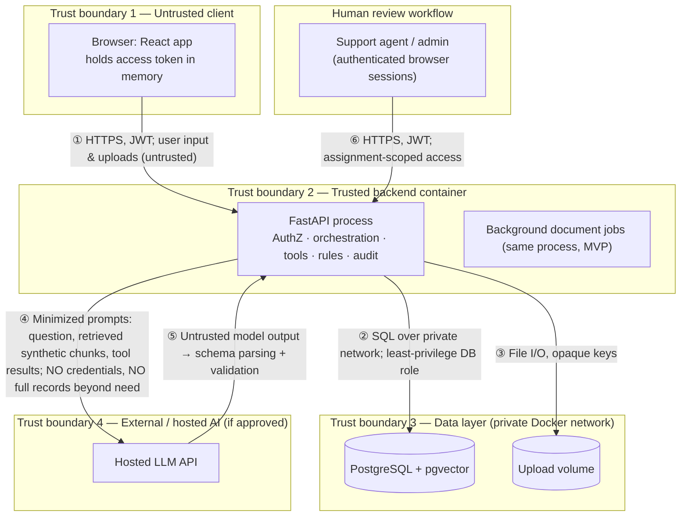

# 04 — System Architecture

The stack below is a **proposed design**. Nothing is installed yet (the workspace contained no code when Phase 1 began).

---

## 1. Technology Stack (proposed)

| Layer | Choice | Notes |
|---|---|---|
| Frontend | React 18 + TypeScript + Vite | React Router for routing; TanStack Query for server state; plain CSS modules + a small accessible component set (no heavy UI library unless Phase 3 finds a need) |
| HTTP client | `fetch` wrapper | Adds token, request ID, standard error parsing |
| Backend | Python 3.12, FastAPI, Pydantic v2 | Uvicorn ASGI server |
| Persistence | SQLAlchemy 2.x (sync engine for simplicity) + Alembic migrations | psycopg 3 driver |
| Database | PostgreSQL 16 + `pgvector` extension | Single datastore for structured data and vectors |
| Vector search | pgvector HNSW index (cosine) + PostgreSQL full-text (`tsvector`) for hybrid retrieval | See ADR-03 |
| LLM | Provider-agnostic `LLMAdapter` (structured output + tool-calling) | Provider pending D-01; deterministic `StubLLM` for tests |
| Embeddings | `EmbeddingAdapter`; provisional local `BAAI/bge-small-en-v1.5` (384-d) via sentence-transformers on CPU | Validate in Phase 4 |
| Orchestration | Plain Python service with explicit steps (no LangGraph in MVP) | ADR-10 |
| PDF | PyMuPDF | Text layer, page rendering for OCR |
| OCR | Tesseract 5 via `pytesseract` | English only in MVP |
| File-type detection | `python-magic` / signature check | Magic-byte validation |
| Background work | FastAPI `BackgroundTasks` in-process for MVP | Job table makes later move to a queue straightforward |
| Auth | Local email/password, argon2id (`argon2-cffi`), JWT (`PyJWT`) | Provisional, D-02 |
| Backend tests | pytest, httpx TestClient, testcontainers/compose Postgres | |
| Frontend tests | Vitest + React Testing Library | |
| E2E | Playwright | |
| AI evaluation | Python scripts over versioned YAML/JSON eval sets | Phase 4/6/8 |
| Packaging | Docker + Docker Compose (`db`, `backend`, `frontend`) | Local-first; D-05 |
| Quality | ruff, mypy, eslint, tsc, pre-commit, secret scanning (gitleaks) | |

---

## 2. Component Responsibilities

| # | Component | Responsibilities | Inputs → Outputs | Depends on | Must NOT control |
|---|---|---|---|---|---|
| 1 | **Web frontend** | Render screens, collect input, show citations/statuses/errors, confirmation dialogs, hide unauthorized navigation | User actions → API calls; API JSON → UI | Backend API | Authorization decisions, business rules, direct DB/AI access |
| 2 | **Backend API (FastAPI routers)** | HTTP contract, request validation, error mapping, request ID, rate limiting, calls services | HTTP → service calls → JSON | Identity/AuthZ, services | Bypassing services to hit DB directly from routes |
| 3 | **Identity & authorization layer** | Verify token, load user, permission map, ownership predicates, audit denials | Token, resource ref → allow/deny + scoped query filters | PostgreSQL (`users`, `members`), Audit | Content generation; it never consults the LLM |
| 4 | **Agent orchestration service** | Classify intent, choose route, manage context window, call RAG/tools/document services, assemble `ChatResponse`, decide escalation offers | Message + user context → structured response | LLM adapter, RAG, Tool service, Rules, Audit | Executing tools without the tool executor; granting permissions |
| 5 | **RAG retrieval service** | Query embedding, hybrid search with permission filters, threshold, conflict detection, citation building | Query + caller scope → ranked permitted chunks | Embedding adapter, PostgreSQL/pgvector | Generation; unfiltered retrieval |
| 6 | **LLM adapter** | Single interface for classification, answer generation, field extraction; timeouts; prompt templates; output schema parsing | Prompt + schema → parsed output | External/hosted or local model | Any data access; tool execution |
| 7 | **Structured-data tool service (tool executor)** | Allowlist, argument validation, permission + ownership checks, execution, result validation, `tool_invocations` records | Tool request + user context → `ToolResult` | Identity/AuthZ, repositories, Audit | Accepting user identity from tool arguments |
| 8 | **Document-processing service** | Upload validation, storage, text extraction, OCR fallback, type classification, schema extraction, grounding check | File → `uploaded_documents`, jobs, `extracted_fields` | File storage, OCR, LLM adapter, Rules | Deciding readiness; serving files publicly |
| 9 | **Business-rule validation service** | Field validation rules, readiness rule engine, case status transitions, escalation rules, next-best-action rules | Data → deterministic outcomes | PostgreSQL | Using LLM output as a decision input other than as extracted, grounded field values |
| 10 | **PostgreSQL** | System of record for all structured data, constraints, transactions | SQL | — | — |
| 11 | **Vector storage (pgvector in PostgreSQL)** | Store chunk embeddings and support ANN search | Embeddings → nearest neighbors | PostgreSQL | Holding member data (knowledge docs only) |
| 12 | **File storage** | Store uploaded and knowledge source files under opaque keys; private volume | Bytes ↔ `storage_key` | Local volume (MVP) | Being web-accessible directly |
| 13 | **Audit & monitoring** | Append-only audit events, structured logs, metric queries | Events → `audit_logs`; logs → stdout | PostgreSQL | Storing content, secrets, tokens |

### 2.1 Backend module layout (planned for Phase 2)

```text
backend/app/
  api/v1/            # routers: health, auth, chat, claims, benefits, documents, authorization, support_cases, admin
  core/              # config, security (jwt, hashing), errors, request_id, rate_limit
  authz/             # permission map, dependencies, ownership scopes
  models/            # SQLAlchemy models
  schemas/           # Pydantic request/response schemas
  repositories/      # DB access, always scope-aware
  services/          # claims, benefits, cases, documents, readiness, metrics, audit
  orchestration/     # intent, router, chat pipeline, escalation, next actions
  rag/               # ingestion, chunking, retrieval, citations
  tools/             # tool registry + executor + tool definitions
  ai/                # LLMAdapter, EmbeddingAdapter, providers, stubs, prompt templates
  documents/         # validation, storage, extraction, ocr, field schemas
  rules/             # field rules, readiness rules, transitions
```

---

## 3. Architecture Diagrams

### 3.1 Component diagram

```mermaid
flowchart LR
    subgraph Client["Browser"]
        FE["React + TS frontend"]
    end
    subgraph Backend["Trusted backend (FastAPI)"]
        API["API routers<br/>validation · errors · rate limits"]
        AUTH["Identity & AuthZ<br/>JWT · permission map · ownership scopes"]
        ORCH["Orchestrator<br/>intent · routing · escalation"]
        RAG["RAG service<br/>hybrid retrieval · citations"]
        TOOLS["Tool executor<br/>allowlist · arg validation · scope"]
        DOCS["Document processor<br/>validate · extract · OCR · fields"]
        RULES["Business rules<br/>field rules · readiness · transitions"]
        VAL["Response validation<br/>citation check · disclaimers"]
        AUD["Audit & logging"]
        LLMA["LLM adapter"]
        EMB["Embedding adapter"]
    end
    subgraph Data["Data layer"]
        PG[("PostgreSQL<br/>structured data")]
        VEC[("pgvector<br/>document_chunks")]
        FS[("File storage<br/>private volume")]
    end
    subgraph External["Model services (pending D-01)"]
        LLM["Approved LLM"]
    end

    FE -->|HTTPS JSON + bearer token| API
    API --> AUTH
    AUTH --> ORCH
    AUTH --> DOCS
    AUTH --> RULES
    ORCH --> RAG
    ORCH --> TOOLS
    ORCH --> LLMA
    RAG --> EMB
    RAG --> VEC
    TOOLS --> AUTH
    TOOLS --> PG
    DOCS --> FS
    DOCS --> LLMA
    DOCS --> RULES
    RULES --> PG
    ORCH --> VAL
    VAL --> API
    LLMA --> LLM
    AUTH --> AUD
    TOOLS --> AUD
    DOCS --> AUD
    RULES --> AUD
    AUD --> PG
    API -->|response| FE
```



### 3.2 Deployment and trust boundaries



| Crossing | Sensitive information | Required controls |
|---|---|---|
| ① Browser → backend | Credentials, messages, uploads | TLS (in any hosted deployment), input validation, size limits, rate limits, JWT verification |
| ② Backend → DB | All structured data | Private network, DB credentials from env, parameterized queries (SQLAlchemy), least-privilege app role (no superuser) |
| ③ Backend → files | Uploaded documents | UUID keys, no path from user input, volume not exposed, retention cleanup |
| ④ Backend → LLM | Question text, synthetic chunks, synthetic tool results, extracted document text | Approved provider only; minimization; no secrets/tokens; provider data-retention terms reviewed (D-01); can be replaced by local model |
| ⑤ LLM → backend | Model output | Treated as untrusted: schema validation, citation validation, tool allowlist, no authorization use |
| ⑥ Reviewers → backend | Case content | Assignment checks per request, audit of status changes |

---

## 4. Request Flow Summary

User interface → Backend API (validation, request ID) → Identity & authorization → Intent classification (routing only) → RAG retrieval **or** tool executor **or** document/readiness service → evidence and result validation → response assembly (citations, disclaimers, proposed actions) → audit event → frontend.

---

## 5. Architecture Decision Records

| ADR | Decision | Context | Alternatives considered | Rationale | Consequences | Open validation |
|---|---|---|---|---|---|---|
| ADR-01 | React + TypeScript (Vite) frontend; FastAPI backend | Need a typed SPA and a Python backend for AI/document libraries | Next.js; Django; Streamlit | Matches the project brief; Python ecosystem for PyMuPDF/OCR/embeddings; FastAPI gives Pydantic validation and OpenAPI generation | Two codebases; CORS configuration; generate TS types from OpenAPI | Phase 2/3 setup |
| ADR-02 | PostgreSQL as the system of record | Relational data with ownership, constraints, transactions | SQLite; MongoDB | Strong constraints, JSONB where needed, mature tooling, pgvector support | Requires Docker/local install | Phase 2 |
| ADR-03 | **pgvector inside PostgreSQL** as the only vector store | MVP ≤ 20k chunks; need metadata filtering (audience, plan, lifecycle) joined with relational data | Chroma; FAISS; managed vector DBs | One datastore, one backup, filters in the same SQL query as permissions, transactional ingestion, hybrid search with full-text in one place | HNSW tuning; embedding dimension fixed per column | Phase 4: recall@k and latency on eval set |
| ADR-04 | RAG instead of model-only answers | Policy answers must be grounded and cited | Fine-tuning; prompt-only | Traceable evidence, updatable docs without retraining, insufficient-evidence detection | Retrieval quality becomes a key risk (R-03) | Phase 4 evaluation |
| ADR-05 | Tools executed only by the backend executor | Prevent unauthorized access via model | Letting the model generate SQL; agent frameworks with direct DB tools | Least privilege; deterministic authorization; auditable | Each new capability requires an explicit tool | Phase 5 security tests |
| ADR-06 | Deterministic readiness rules | Readiness must be predictable and traceable | LLM judgement of completeness | Reproducible results, explainable per rule, testable | Rules must be authored per requirement set; limited flexibility | Phase 6 labeled set |
| ADR-07 | Human escalation through support cases with explicit user confirmation | Unresolved/sensitive requests need a person | Auto-creating cases; email handoff | Avoids unwanted actions; honest status; one reviewable queue | Extra click for users | Phase 7 |
| ADR-08 | Synthetic development data only | No approved real data | Public datasets with real-looking PHI | Eliminates real PHI exposure; safe to share demos | Realism limited; evaluation results may not transfer | Ongoing |
| ADR-09 | Local private file volume behind a `FileStorage` interface | No approved object storage | S3/MinIO; storing files in DB | Simple; swap later via interface; keeps DB small | Single-node only; backups manual | D-04 |
| ADR-10 | Plain Python orchestration, single assistant (no multi-agent, no LangGraph in MVP) | Workflow is a bounded set of routes | LangGraph; LangChain agents; multiple agents | Fewer dependencies, easier testing, explicit control flow | Re-evaluate if branching grows (future) | Phase 4/5 review |
| ADR-11 | Local auth with JWT access tokens (provisional) | No approved IdP | OIDC (Keycloak/Auth0); session cookies | Simple, testable; isolated to `core/security` for later OIDC swap | Must implement rate limiting and token deny-list | D-02 |
| ADR-12 | Provider-agnostic LLM adapter with a stub provider | Provider not approved yet | Hard-coding one SDK | Unblocks development and deterministic tests | Adapter abstraction cost | D-01 |
