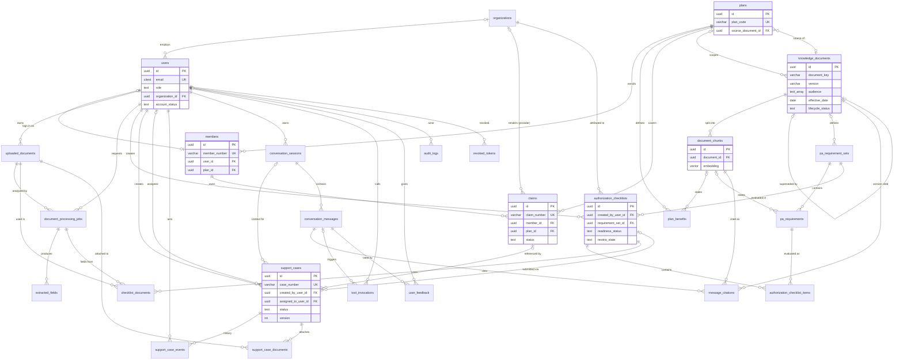

# 05 — Database and Data Model Design

Design specification only — migrations are created in Phase 2. Target: PostgreSQL 16 with `pgvector` and `pgcrypto` (for `gen_random_uuid()`).

## 0. Conventions

- `snake_case` table and column names; plural table names.
- Primary keys: `id uuid DEFAULT gen_random_uuid()`.
- Human-readable public references where users type them: `members.member_number`, `plans.plan_code`, `claims.claim_number`, `support_cases.case_number`, `pa_requirement_sets.procedure_code`.
- Timestamps: `timestamptz`, stored in UTC; `created_at DEFAULT now()`; `updated_at` maintained by the application on update.
- Enumerations: `text` + `CHECK (col IN (...))` using the values in doc 02 §3 (easier to evolve than PG enums).
- Synthetic marker: `is_synthetic boolean NOT NULL DEFAULT true` on every business-data table; seed and CI tests fail if any row has `false` in non-approved environments.
- Delete rules: `ON DELETE RESTRICT` by default; `CASCADE` only for pure child rows noted below.

> **Phase 2 implementation status:** revision `0001` creates `organizations`, `users`, `members`, `plans`, `plan_benefits`, `claims`, `audit_logs` and `revoked_tokens`. The remaining tables are created by the phase that first uses them. `plans.source_document_id` and `plan_benefits.source_chunk_id` arrive with the Phase 4 knowledge tables, and `users.email` is `varchar(254)` with a lowercase CHECK instead of `citext`. See `docs/phase-2/implementation-notes.md` (D2-01 to D2-04, D2-09).

## 1. Entity List and Changes from the Initial List

| # | Table | Status vs. master list | Reason |
|---|---|---|---|
| 1 | `organizations` | Included | Provider practice and support-center membership; assignee validation |
| 2 | `users` | Included | Login accounts and roles |
| 3 | `members` | **Added** | Separates the synthetic insured member (member number, plan) from the login account; claims belong to members |
| 4 | `plans` | Included | Plan-level information |
| 5 | `plan_benefits` | **Added** | Normalized benefit entries per plan with source references, instead of an unstructured blob |
| 6 | `claims` | Included | Individual synthetic claims |
| 7 | `knowledge_documents` | Included | Versioned knowledge source metadata |
| 8 | `document_chunks` | Included | Chunk text, embedding, and passage location |
| 9 | `uploaded_documents` | **Added** | User-uploaded file metadata (distinct from knowledge documents) |
| 10 | `document_processing_jobs` | Included | Analysis runs per uploaded document |
| 11 | `extracted_fields` | **Added** | Field-level raw/normalized values and validation status |
| 12 | `pa_requirement_sets` | **Added** | Configured (fictional) requirement set per procedure/workflow |
| 13 | `pa_requirements` | **Added** | Individual requirements with deterministic rules and source chunks |
| 14 | `authorization_checklists` | Included | Readiness checklist header |
| 15 | `authorization_checklist_items` | Included | One item per requirement |
| 16 | `checklist_documents` | **Added** | Many-to-many: which documents/jobs a checklist used |
| 17 | `support_cases` | Included | Case records |
| 18 | `support_case_events` | **Added** | Status/assignment history and notes |
| 19 | `support_case_documents` | **Added** | Many-to-many: documents attached to a case |
| 20 | `conversation_sessions` | Included | Chat sessions |
| 21 | `conversation_messages` | Included | Messages with routing/evidence metadata |
| 22 | `message_citations` | **Added** | Validated citations per assistant message |
| 23 | `tool_invocations` | **Added** | Tool request/outcome records for metrics and debugging |
| 24 | `audit_logs` | Included | Append-only security/audit trail |
| 25 | `user_feedback` | Included | Answer ratings |
| 26 | `revoked_tokens` | **Added** | Logout deny-list for JWT `jti` until expiry |

---

## 2. Table Specifications

Legend: **PK** primary key, **FK** foreign key, **UQ** unique, **NN** not null.

### 2.1 `organizations`
| Column | Type | Null | Key | Default | Purpose / validation |
|---|---|---|---|---|---|
| id | uuid | NN | PK | gen_random_uuid() | |
| name | varchar(200) | NN | UQ | | Fictional name, e.g. "Maplestone Family Clinic (fictional)" |
| org_type | text | NN | | | CHECK in (`PROVIDER_PRACTICE`,`SUPPORT_CENTER`) |
| is_synthetic | boolean | NN | | true | |
| created_at | timestamptz | NN | | now() | |

### 2.2 `users`
| Column | Type | Null | Key | Default | Purpose / validation |
|---|---|---|---|---|---|
| id | uuid | NN | PK | | |
| email | citext | NN | UQ | | Lower-cased; `@example.test` domain for seeds |
| display_name | varchar(120) | NN | | | |
| password_hash | varchar(255) | NULL | | | argon2id encoded hash; NULL only if an external IdP is used later |
| role | text | NN | | | CHECK in (`MEMBER`,`PROVIDER`,`SUPPORT_AGENT`,`ADMIN`) |
| organization_id | uuid | NULL | FK → organizations.id | | Required for PROVIDER (`PROVIDER_PRACTICE`) and SUPPORT_AGENT (`SUPPORT_CENTER`); NULL for MEMBER — enforced by CHECK + service validation |
| account_status | text | NN | | 'ACTIVE' | CHECK in (`ACTIVE`,`DISABLED`) |
| failed_login_count | integer | NN | | 0 | Rate limiting support |
| last_login_at | timestamptz | NULL | | | |
| is_synthetic | boolean | NN | | true | |
| created_at / updated_at | timestamptz | NN | | now() | |

Indexes: UQ(email); idx(role); idx(organization_id).
CHECK: `(role IN ('PROVIDER','SUPPORT_AGENT') AND organization_id IS NOT NULL) OR (role IN ('MEMBER','ADMIN'))`.

### 2.3 `members`
| Column | Type | Null | Key | Default | Purpose / validation |
|---|---|---|---|---|---|
| id | uuid | NN | PK | | |
| member_number | varchar(20) | NN | UQ | | Pattern `SYN-M-\d{6}` |
| user_id | uuid | NULL | UQ, FK → users.id | | Login account (role MEMBER); NULL for members without accounts |
| plan_id | uuid | NN | FK → plans.id | | Current plan |
| coverage_start | date | NN | | | |
| coverage_end | date | NULL | | | CHECK coverage_end ≥ coverage_start |
| is_synthetic | boolean | NN | | true | |
| created_at / updated_at | timestamptz | NN | | now() | |

No names, birth dates, addresses or other personal attributes are stored — the display name lives on `users` and is fictional.

### 2.4 `plans`
| Column | Type | Null | Key | Default | Purpose |
|---|---|---|---|---|---|
| id | uuid | NN | PK | | |
| plan_code | varchar(30) | NN | UQ | | e.g. `SYN-PLAN-GOLD-01` |
| plan_name | varchar(150) | NN | | | |
| plan_year | integer | NN | | | CHECK 2000–2100 |
| effective_start | date | NN | | | |
| effective_end | date | NULL | | | |
| summary | text | NULL | | | Short description |
| source_document_id | uuid | NULL | FK → knowledge_documents.id | | Benefit guide that defines this plan |
| is_active | boolean | NN | | true | |
| is_synthetic | boolean | NN | | true | |
| created_at / updated_at | timestamptz | NN | | now() | |

### 2.5 `plan_benefits`
| Column | Type | Null | Key | Default | Purpose / validation |
|---|---|---|---|---|---|
| id | uuid | NN | PK | | |
| plan_id | uuid | NN | FK → plans.id ON DELETE CASCADE | | |
| benefit_category | varchar(60) | NN | | | e.g. `PRIMARY_CARE`, `IMAGING`, `PHYSICAL_THERAPY` |
| service_name | varchar(150) | NN | | | |
| in_network_cost_share | varchar(100) | NULL | | | Synthetic text, e.g. "$25 copay" |
| out_of_network_cost_share | varchar(100) | NULL | | | |
| prior_auth_required | boolean | NN | | false | Informational (from fictional guide) |
| visit_limit | varchar(100) | NULL | | | e.g. "20 visits per plan year" |
| limitations | text | NULL | | | |
| source_chunk_id | uuid | NULL | FK → document_chunks.id ON DELETE SET NULL | | Passage that states this benefit |
| created_at / updated_at | timestamptz | NN | | now() | |

UQ(plan_id, benefit_category, service_name). Idx(plan_id).

### 2.6 `claims`
| Column | Type | Null | Key | Default | Purpose / validation |
|---|---|---|---|---|---|
| id | uuid | NN | PK | | |
| claim_number | varchar(25) | NN | UQ | | Pattern `SYN-CLM-\d{4}-\d{6}` |
| member_id | uuid | NN | FK → members.id | | **Ownership** |
| plan_id | uuid | NN | FK → plans.id | | Plan at time of service |
| provider_organization_id | uuid | NULL | FK → organizations.id | | Fictional rendering provider |
| service_date | date | NN | | | |
| submission_date | date | NN | | | CHECK ≥ service_date |
| status | text | NN | | | CHECK in claim statuses (doc 02 §3.9) |
| status_reason_code | varchar(20) | NULL | | | e.g. `PI-01` (fictional) |
| status_description | varchar(300) | NULL | | | Synthetic, non-clinical explanation |
| billed_amount | numeric(10,2) | NULL | | | Synthetic |
| last_status_change_at | timestamptz | NN | | | "Last updated" shown to users |
| is_synthetic | boolean | NN | | true | |
| created_at / updated_at | timestamptz | NN | | now() | |

Indexes: UQ(claim_number); idx(member_id, submission_date DESC); idx(status).
No diagnosis codes or clinical notes are stored.

### 2.7 `knowledge_documents`
| Column | Type | Null | Key | Default | Purpose / validation |
|---|---|---|---|---|---|
| id | uuid | NN | PK | | |
| document_key | varchar(80) | NN | | | Stable logical ID across versions, e.g. `pa-guide-imaging` |
| title | varchar(250) | NN | | | |
| version | varchar(30) | NN | | | e.g. `1.2` |
| document_type | text | NN | | | CHECK in (`BENEFIT_GUIDE`,`FAQ`,`PROCESS_MANUAL`,`PA_REQUIREMENTS`,`CLAIMS_GUIDE`,`SUPPORT_PROCEDURE`) |
| audience | text[] | NN | | | Subset of {`MEMBER`,`PROVIDER`,`SUPPORT_INTERNAL`}; CHECK non-empty |
| plan_id | uuid | NULL | FK → plans.id | | NULL = applies to all plans |
| effective_date | date | NULL | | | **NULL when the source does not state one — never inferred** |
| expiration_date | date | NULL | | | |
| source_filename | varchar(255) | NN | | | |
| storage_key | varchar(255) | NN | | | Location of source file |
| content_sha256 | char(64) | NN | | | Idempotent ingestion |
| ingestion_status | text | NN | | 'PENDING_INGESTION' | CHECK |
| ingestion_error_code | varchar(50) | NULL | | | |
| lifecycle_status | text | NN | | 'ACTIVE' | CHECK (`ACTIVE`,`SUPERSEDED`,`RETIRED`) |
| superseded_by_id | uuid | NULL | FK → knowledge_documents.id | | |
| page_count | integer | NULL | | | |
| ingested_at | timestamptz | NULL | | | |
| is_synthetic | boolean | NN | | true | |
| created_at / updated_at | timestamptz | NN | | now() | |

UQ(document_key, version); partial UQ(document_key) WHERE lifecycle_status = 'ACTIVE' (one active version per key); GIN(audience); idx(lifecycle_status, document_type).

### 2.8 `document_chunks`
| Column | Type | Null | Key | Default | Purpose |
|---|---|---|---|---|---|
| id | uuid | NN | PK | | |
| document_id | uuid | NN | FK → knowledge_documents.id ON DELETE CASCADE | | |
| chunk_index | integer | NN | | | Order within document |
| section_heading | varchar(300) | NULL | | | Nearest heading path |
| page_start | integer | NULL | | | Source page (PDF) |
| page_end | integer | NULL | | | |
| char_start | integer | NN | | | Offset in extracted text |
| char_end | integer | NN | | | |
| content | text | NN | | | Chunk text (the only copy of passage text) |
| content_tsv | tsvector | NN | | generated | `GENERATED ALWAYS AS (to_tsvector('english', content)) STORED` |
| token_count | integer | NN | | | |
| embedding | vector(384) | NN | | | Dimension per A-03 |
| embedding_model | varchar(100) | NN | | | e.g. `bge-small-en-v1.5` |
| created_at | timestamptz | NN | | now() | |

UQ(document_id, chunk_index); HNSW(embedding vector_cosine_ops); GIN(content_tsv). Audience/plan/lifecycle filters join to `knowledge_documents` (no duplication).

### 2.9 `uploaded_documents`
| Column | Type | Null | Key | Default | Purpose / validation |
|---|---|---|---|---|---|
| id | uuid | NN | PK | | |
| owner_user_id | uuid | NN | FK → users.id | | **Ownership** |
| original_filename | varchar(255) | NN | | | Sanitized display name only; never used as a path |
| storage_key | varchar(255) | NN | UQ | | `uploads/{uuid}` |
| mime_type | text | NN | | | CHECK in (`application/pdf`,`image/png`,`image/jpeg`) |
| size_bytes | bigint | NN | | | CHECK > 0 AND ≤ configured max |
| page_count | integer | NN | | | Images = 1 |
| content_sha256 | char(64) | NN | | | |
| declared_purpose | text | NULL | | | CHECK in (`PA_REQUEST`,`SUPPORTING_DOCUMENT`,`OTHER`) |
| expires_at | timestamptz | NN | | | created_at + retention |
| deleted_at | timestamptz | NULL | | | Soft delete; file removed by cleanup |
| is_synthetic | boolean | NN | | true | Upload screen states synthetic-only use |
| created_at | timestamptz | NN | | now() | |

Idx(owner_user_id, created_at DESC); idx(expires_at).

### 2.10 `document_processing_jobs`
| Column | Type | Null | Key | Default | Purpose |
|---|---|---|---|---|---|
| id | uuid | NN | PK | | |
| uploaded_document_id | uuid | NN | FK → uploaded_documents.id ON DELETE CASCADE | | |
| requested_by_user_id | uuid | NN | FK → users.id | | Must equal owner |
| status | text | NN | | 'QUEUED' | CHECK job statuses |
| detected_document_type | text | NULL | | | CHECK in (`PA_REQUEST_FORM`,`CLINICAL_NOTE_SUMMARY`,`REFERRAL_LETTER`,`CLAIM_SUPPORT_LETTER`,`UNRECOGNIZED`) |
| pages_text_layer | integer | NN | | 0 | |
| pages_ocr | integer | NN | | 0 | |
| ocr_mean_confidence | numeric(5,2) | NULL | | | 0–100 |
| extraction_schema_version | varchar(20) | NULL | | | |
| warning_count | integer | NN | | 0 | |
| error_code | varchar(50) | NULL | | | Set when FAILED |
| started_at / completed_at | timestamptz | NULL | | | |
| created_at | timestamptz | NN | | now() | |

Idx(uploaded_document_id, created_at DESC); idx(status). Extracted full text is **not** stored in the DB; it is held transiently and, if needed for re-display, re-derived from the file.

### 2.11 `extracted_fields`
| Column | Type | Null | Key | Default | Purpose |
|---|---|---|---|---|---|
| id | uuid | NN | PK | | |
| job_id | uuid | NN | FK → document_processing_jobs.id ON DELETE CASCADE | | |
| field_name | varchar(60) | NN | | | From schema (doc 07 §5.3) |
| raw_value | text | NULL | | | Exactly as found in document text (NULL if `ABSENT`) |
| normalized_value | text | NULL | | | After deterministic normalization (e.g., ISO date); NULL unless `VALID` or `LOW_CONFIDENCE` |
| validation_status | text | NN | | | CHECK field statuses (doc 02 §3.3) |
| validation_message | varchar(300) | NULL | | | Safe explanation |
| source_page | integer | NULL | | | |
| extraction_method | text | NULL | | | `TEXT_LAYER` / `OCR` |
| confidence | numeric(4,3) | NULL | | | Extractor/OCR signal; not a calibrated probability |
| created_at | timestamptz | NN | | now() | |

UQ(job_id, field_name).
Separation of concerns: `raw_value` = what the document contains; `normalized_value` = validated value; `validation_status` encodes missing/unreadable/human-check. Model inferences that are not found in text are discarded, so they are never stored.

### 2.12 `pa_requirement_sets`
| Column | Type | Null | Key | Default | Purpose |
|---|---|---|---|---|---|
| id | uuid | NN | PK | | |
| procedure_code | varchar(40) | NN | | | Fictional, e.g. `SYN-PROC-MRI-LUMBAR` |
| display_name | varchar(150) | NN | | | |
| aliases | text[] | NN | | '{}' | Names used for matching chat requests |
| version | varchar(20) | NN | | | |
| source_document_id | uuid | NULL | FK → knowledge_documents.id | | Requirement document. NULL only between Phase 2 seeding and Phase 4 ingestion; the `get_required_documents` tool (Phase 5) treats a set without a source as not active |
| is_active | boolean | NN | | true | |
| is_synthetic | boolean | NN | | true | |
| created_at | timestamptz | NN | | now() | |

UQ(procedure_code, version); partial UQ(procedure_code) WHERE is_active.

### 2.13 `pa_requirements`
| Column | Type | Null | Key | Default | Purpose |
|---|---|---|---|---|---|
| id | uuid | NN | PK | | |
| requirement_set_id | uuid | NN | FK → pa_requirement_sets.id ON DELETE CASCADE | | |
| requirement_code | varchar(40) | NN | | | e.g. `REQ-MRI-03` |
| description | varchar(300) | NN | | | |
| is_mandatory | boolean | NN | | true | |
| rule_type | text | NN | | | CHECK rule types (doc 02 §3.9) |
| rule_params | jsonb | NN | | '{}' | e.g. `{"field":"conservative_therapy_weeks","min":6}`; validated by Pydantic per rule type |
| source_chunk_id | uuid | NULL | FK → document_chunks.id ON DELETE SET NULL | | Passage that states the requirement |
| display_order | integer | NN | | | |

UQ(requirement_set_id, requirement_code).

### 2.14 `authorization_checklists`
| Column | Type | Null | Key | Default | Purpose |
|---|---|---|---|---|---|
| id | uuid | NN | PK | | |
| created_by_user_id | uuid | NN | FK → users.id | | **Ownership** (PROVIDER) |
| organization_id | uuid | NN | FK → organizations.id | | Creator's practice (attribution) |
| requirement_set_id | uuid | NN | FK → pa_requirement_sets.id | | Exact set/version used |
| readiness_status | text | NN | | | CHECK (doc 02 §3.5) |
| review_state | text | NN | | 'NOT_SUBMITTED' | CHECK (doc 02 §3.6) |
| satisfied_count / missing_count / unreadable_count / manual_review_count | integer | NN | | 0 | Denormalized counts for display/metrics |
| reviewer_summary | text | NULL | | | Template output |
| provider_note | varchar(2000) | NULL | | | Optional user note |
| disclaimer_version | varchar(10) | NN | | | Disclaimer text version shown |
| created_at / updated_at | timestamptz | NN | | now() | |

Idx(created_by_user_id, created_at DESC).

### 2.15 `authorization_checklist_items`
| Column | Type | Null | Key | Default | Purpose |
|---|---|---|---|---|---|
| id | uuid | NN | PK | | |
| checklist_id | uuid | NN | FK → authorization_checklists.id ON DELETE CASCADE | | |
| requirement_id | uuid | NN | FK → pa_requirements.id | | Rule + source used |
| item_status | text | NN | | | CHECK (doc 02 §3.4) |
| evidence_field_ids | uuid[] | NN | | '{}' | `extracted_fields.id` values used (validated in service) |
| explanation | varchar(500) | NN | | | Deterministic text, e.g. "Field `ordering_provider_npi` ABSENT in all documents" |

UQ(checklist_id, requirement_id).

### 2.16 `checklist_documents`
| Column | Type | Null | Key | Purpose |
|---|---|---|---|---|
| checklist_id | uuid | NN | PK, FK → authorization_checklists.id ON DELETE CASCADE | |
| uploaded_document_id | uuid | NN | PK, FK → uploaded_documents.id | |
| job_id | uuid | NN | FK → document_processing_jobs.id | Exact job whose fields were evaluated |

### 2.17 `support_cases`
| Column | Type | Null | Key | Default | Purpose / validation |
|---|---|---|---|---|---|
| id | uuid | NN | PK | | |
| case_number | varchar(20) | NN | UQ | | `CASE-YYYY-NNNNNN` from a sequence |
| created_by_user_id | uuid | NN | FK → users.id | | **Ownership** |
| assigned_to_user_id | uuid | NULL | FK → users.id | | Must be active SUPPORT_AGENT |
| category | text | NN | | | CHECK categories |
| status | text | NN | | 'OPEN' | CHECK case statuses |
| escalation_reason | text | NN | | 'USER_INITIATED' | CHECK reasons (doc 02 §3.7) |
| summary | varchar(2000) | NN | | | CHECK length ≥ 10 |
| related_session_id | uuid | NULL | FK → conversation_sessions.id ON DELETE SET NULL | | Conversation context (creator's own) |
| related_claim_id | uuid | NULL | FK → claims.id | | Must be creator's claim |
| related_checklist_id | uuid | NULL | FK → authorization_checklists.id | | Must be creator's checklist |
| evidence_references | jsonb | NN | | '[]' | List of `{chunk_id, document_id, document_version}` validated at creation |
| resolution_note | varchar(2000) | NULL | | | Required when RESOLVED |
| idempotency_key | uuid | NN | | | From `Idempotency-Key` header |
| version | integer | NN | | 1 | Optimistic locking |
| resolved_at / closed_at | timestamptz | NULL | | | |
| created_at / updated_at | timestamptz | NN | | now() | |

UQ(case_number); UQ(created_by_user_id, idempotency_key); idx(assigned_to_user_id, status); idx(status, created_at); idx(created_by_user_id, created_at DESC).

### 2.18 `support_case_events`
| Column | Type | Null | Key | Default | Purpose |
|---|---|---|---|---|---|
| id | uuid | NN | PK | | |
| case_id | uuid | NN | FK → support_cases.id ON DELETE CASCADE | | |
| actor_user_id | uuid | NN | FK → users.id | | |
| event_type | text | NN | | | CHECK event types |
| from_status | text | NULL | | | |
| to_status | text | NULL | | | |
| from_assignee_id / to_assignee_id | uuid | NULL | FK → users.id | | |
| note | varchar(2000) | NULL | | | Visible to creator and assigned agent |
| created_at | timestamptz | NN | | now() | |

Idx(case_id, created_at). Append-only (no UPDATE/DELETE by app role).

### 2.19 `support_case_documents`
| Column | Type | Null | Key | Purpose |
|---|---|---|---|---|
| case_id | uuid | NN | PK, FK → support_cases.id ON DELETE CASCADE | |
| uploaded_document_id | uuid | NN | PK, FK → uploaded_documents.id | Must be owned by case creator at link time |
| linked_at | timestamptz | NN | | |

### 2.20 `conversation_sessions`
| Column | Type | Null | Key | Default | Purpose |
|---|---|---|---|---|---|
| id | uuid | NN | PK | | |
| user_id | uuid | NN | FK → users.id | | **Ownership** |
| title | varchar(120) | NN | | | First message excerpt |
| last_message_at | timestamptz | NN | | now() | |
| expires_at | timestamptz | NN | | | Retention |
| created_at | timestamptz | NN | | now() | |

Idx(user_id, last_message_at DESC); idx(expires_at).

### 2.21 `conversation_messages`
| Column | Type | Null | Key | Default | Purpose |
|---|---|---|---|---|---|
| id | uuid | NN | PK | | |
| session_id | uuid | NN | FK → conversation_sessions.id ON DELETE CASCADE | | |
| sender | text | NN | | | `USER` / `ASSISTANT` |
| content | text | NN | | | CHECK length ≤ 8000 |
| client_message_id | uuid | NULL | | | Dedup for user messages |
| intent | text | NULL | | | Intent enum (doc 07 §1); on USER messages |
| answer_type | text | NULL | | | On ASSISTANT messages |
| evidence_status | text | NULL | | | |
| citation_check | text | NULL | | | |
| escalation_offered | boolean | NN | | false | |
| escalation_reason | text | NULL | | | |
| escalation_declined | boolean | NN | | false | |
| proposed_actions | jsonb | NN | | '[]' | Allowed action types only |
| gap_topic | varchar(120) | NULL | | | Normalized topic for INSUFFICIENT/CONFLICTING (FR-033) |
| latency_ms | integer | NULL | | | Assistant messages |
| created_at | timestamptz | NN | | now() | |

UQ(session_id, client_message_id) WHERE client_message_id IS NOT NULL; idx(session_id, created_at); idx(created_at, evidence_status); idx(intent).

### 2.22 `message_citations`
| Column | Type | Null | Key | Purpose |
|---|---|---|---|---|
| id | uuid | NN | PK | |
| message_id | uuid | NN | FK → conversation_messages.id ON DELETE CASCADE | Assistant message |
| chunk_id | uuid | NN | FK → document_chunks.id | Must be in retrieved set |
| document_id | uuid | NN | FK → knowledge_documents.id | Version at time of answer |
| marker | varchar(10) | NN | | e.g. `C1` |
| retrieval_rank | integer | NN | | |
| retrieval_score | numeric(6,4) | NN | | |

UQ(message_id, marker).

### 2.23 `tool_invocations`
| Column | Type | Null | Key | Purpose |
|---|---|---|---|---|
| id | uuid | NN | PK | |
| message_id | uuid | NULL | FK → conversation_messages.id ON DELETE SET NULL | Chat context (NULL if called from API service) |
| user_id | uuid | NN | FK → users.id | Caller |
| tool_name | text | NN | | CHECK in (`get_claim_status`,`get_plan_benefits`,`get_required_documents`,`create_support_case`) |
| arguments_redacted | jsonb | NN | | Public refs only (claim number, plan code, procedure code); summary text omitted |
| result_status | text | NN | | CHECK tool statuses |
| latency_ms | integer | NN | | |
| created_at | timestamptz | NN | now() | |

Idx(created_at, tool_name, result_status).

### 2.24 `audit_logs`
| Column | Type | Null | Key | Default | Purpose |
|---|---|---|---|---|---|
| id | bigint | NN | PK (identity) | | Ordered, append-only |
| occurred_at | timestamptz | NN | | now() | |
| request_id | uuid | NULL | | | Correlates with logs/error responses |
| actor_user_id | uuid | NULL | FK → users.id ON DELETE SET NULL | | NULL for anonymous (failed login on unknown email) |
| actor_role | text | NULL | | | Role at time of event |
| action | varchar(60) | NN | | | Catalogue in doc 09 §5 |
| resource_type | varchar(40) | NULL | | | e.g. `claim`, `support_case` |
| resource_ref | varchar(80) | NULL | | | Public ref or UUID — never content |
| outcome | text | NN | | | `SUCCESS`/`DENIED`/`FAILURE` |
| reason_code | varchar(50) | NULL | | | e.g. `NOT_OWNER` |
| metadata | jsonb | NN | | '{}' | Allowlisted keys only (e.g., `from_status`, `to_status`, `tool_name`, `mime_type`) |

Idx(occurred_at DESC); idx(action, occurred_at); idx(actor_user_id, occurred_at); idx(outcome). App DB role has INSERT/SELECT only (no UPDATE/DELETE) on this table; retention purge runs under a separate maintenance role.

### 2.25 `user_feedback`
| Column | Type | Null | Key | Default | Purpose |
|---|---|---|---|---|---|
| id | uuid | NN | PK | | |
| message_id | uuid | NN | FK → conversation_messages.id ON DELETE CASCADE | | ASSISTANT message |
| user_id | uuid | NN | FK → users.id | | Must own the session |
| rating | text | NN | | | `HELPFUL`/`NOT_HELPFUL` |
| comment | varchar(500) | NULL | | | |
| created_at / updated_at | timestamptz | NN | | now() | |

UQ(message_id, user_id).

### 2.26 `revoked_tokens`
| Column | Type | Null | Key | Purpose |
|---|---|---|---|---|
| jti | uuid | NN | PK | Token ID |
| user_id | uuid | NN | FK → users.id ON DELETE CASCADE | |
| expires_at | timestamptz | NN | | Row purged after expiry |

---

## 3. Claims, Benefits and Policy Requirements — Authoritative Sources

| Question type | Authoritative source | Retrieved by | Never from |
|---|---|---|---|
| "What is the status of my claim?" | `claims` row (status, dates) | `get_claim_status` / `GET /claims/{claim_number}` | LLM text, knowledge documents |
| "What does PENDING_INFORMATION mean?" | `CLAIMS_GUIDE` knowledge document | RAG | Claims table descriptions alone |
| "What does my plan cover for imaging?" | `plan_benefits` row (+ its `source_chunk_id`) | `get_plan_benefits` | LLM general knowledge |
| "How do I appeal / general process?" | `PROCESS_MANUAL`/`FAQ` documents | RAG | — |
| "What documents are needed for procedure X?" | `pa_requirements` of the active set (+ source chunk) | `get_required_documents` | Free generation |
| "Is my authorization approved?" | **No source exists in the MVP** | Fixed explanation (FR-024) | Anything |

Claim status, plan benefit terms and administrative requirements are three distinct record types and are never substituted for one another.

## 4. Knowledge-Base Design

- A **document** is one version of a logical source (`document_key` + `version`). Only one version per key may be `ACTIVE`.
- Ingesting a new version: insert new row → ingest chunks → in one transaction set the previous version `SUPERSEDED` and `superseded_by_id`.
- **Chunks** carry location (`page_start/end`, `char_start/end`, `section_heading`) so citations point to a passage, plus `embedding_model` for re-embedding audits.
- Access metadata (`audience`, `plan_id`, `lifecycle_status`) lives only on the document and is joined during retrieval.
- `effective_date` is NULL when not stated by the source; the UI shows "Effective date not stated".
- Superseded documents are retained for traceability of past answers (`message_citations.document_id` still resolves) but excluded from retrieval.

## 5. Document-Processing Design

```
uploaded_documents (file metadata, owner)
   └── document_processing_jobs (one per analysis run, status, method stats)
          └── extracted_fields (one per schema field: raw, normalized, validation_status)
authorization_checklists ── checklist_documents ──> (uploaded_document, job used)
   └── authorization_checklist_items ──> pa_requirements (rule, source chunk)
                                     └── evidence_field_ids ──> extracted_fields
```

| Concept | Representation |
|---|---|
| Extracted raw value | `extracted_fields.raw_value` |
| Validated value | `extracted_fields.normalized_value` with `validation_status = VALID` |
| Missing information | Field `ABSENT`; checklist item `MISSING` |
| Unreadable information | Field `ILLEGIBLE`/`LOW_CONFIDENCE`; item `UNREADABLE` |
| Needs human verification | Field `INCONSISTENT`/`INVALID_FORMAT`; item `NEEDS_MANUAL_REVIEW` |
| Model inference not in document | Not stored (discarded by grounding check) |

## 6. Support Case and Audit Design

- **Ownership:** `created_by_user_id` is set from the token; linked claim/checklist/documents/session must belong to that user at creation.
- **Assignment:** `assigned_to_user_id` validated against role/status/organization; every change writes an `ASSIGNED`/`UNASSIGNED` event.
- **Status transitions:** validated against the table in doc 02 §3.1 inside a transaction using `UPDATE … WHERE id = :id AND version = :version`; zero rows → `VERSION_CONFLICT`.
- **History:** `support_case_events` is append-only and drives the case timeline.
- **Audit:** `audit_logs` records security-relevant actions with metadata only. `metadata` keys are allowlisted in code; free text, message content, document text and extracted values are rejected.

## 7. Entity-Relationship Diagram



**Main relationship paths**
- *Member data:* `users → members → claims` and `members → plans → plan_benefits`. Every claim query starts from the caller's `members` row.
- *Knowledge:* `knowledge_documents → document_chunks → message_citations → conversation_messages`; superseded versions remain linked for past citations.
- *Readiness:* `uploaded_documents → document_processing_jobs → extracted_fields`, evaluated against `pa_requirement_sets → pa_requirements` into `authorization_checklists → authorization_checklist_items`, with `checklist_documents` recording exactly which job was used.
- *Support:* `support_cases` link a creator, optional assignee, conversation, claim, checklist and documents; `support_case_events` gives the history; `audit_logs` gives the security trail.

## 8. Seed Data Plan (for Phase 2)

| Entity | Synthetic seed |
|---|---|
| organizations | "Maplestone Family Clinic (fictional)" (`PROVIDER_PRACTICE`), "IHSA Synthetic Support Center" (`SUPPORT_CENTER`) |
| users | 3 members, 2 providers, 2 support agents, 1 admin — `@example.test` emails; passwords from a seed env var, never committed |
| plans | `SYN-PLAN-GOLD-01`, `SYN-PLAN-BRONZE-01` |
| plan_benefits | ~10 entries per plan (primary care, imaging, PT, specialist, ER) |
| claims | ~15 claims covering every claim status, split across members |
| pa_requirement_sets | `SYN-PROC-MRI-LUMBAR` (6 requirements), `SYN-PROC-PT-EXTENDED` (4 requirements) |
| knowledge documents | Written in Phase 4: 2 benefit guides, FAQ, claims guide, 2 PA requirement guides (one with a superseded version), support procedure |
