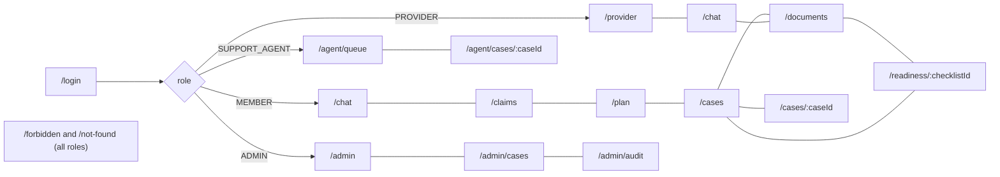

# 08 — UI Wireframes and Navigation Design

Low-fidelity wireframes for Phase 3. All actions map to API routes in doc 06. A persistent footer on every authenticated screen reads: **"Prototype using synthetic data — not a real insurance service."**

---

## 1. Information Architecture



---

## 2. Screens

### Screen 1 — Login (`/login`)
```
┌──────────────────────────────────────────────┐
│  IHSA — Intelligent Healthcare Support Agent │
│  Synthetic prototype · not an Evernorth product│
│                                              │
│  Email     [______________________________]  │
│  Password  [______________________________]  │
│            [ Sign in ]                       │
│                                              │
│  ⚠ "Email or password is incorrect."        │  ← generic error (401)
│  ⚠ "Too many attempts. Try again in 12 min." │  ← 429 with Retry-After
└──────────────────────────────────────────────┘
```
- `POST /auth/login`; on success `GET /auth/me` and redirect to role home.
- Client validation: required fields, email format; server message shown as-is (generic).
- Token kept in memory only (not localStorage); page reload → re-login (MVP, documented). No SSO button (no approved IdP).
- Button disabled + spinner while submitting.

### Screen 2 — Member Chat (`/chat`)
```
┌ Nav: [Chat] [My claims] [My plan] [Documents] [Support cases]     Priya ▾ [Sign out] ┐
├──────────────┬────────────────────────────────────────────────────────────────────┤
│ Conversations│  ┌ Assistant ──────────────────────────────────────────────────┐   │
│ + New chat   │  │ Your claim SYN-CLM-2026-000101                               │   │
│ ▸ Claim help │  │ ┌ From your claim record ─────────────────────────┐          │   │
│ ▸ PT benefits│  │ │ Status: PENDING_INFORMATION (Pending information)│          │   │
│              │  │ │ Submitted 2026-08-20 · Updated 2026-09-02        │          │   │
│              │  │ └──────────────────────────────────────────────────┘          │   │
│              │  │ "Pending information" means the claim needs more documents   │   │
│              │  │ before processing can continue [C1].                          │   │
│              │  │ Evidence: ✔ Verified record + 1 source                        │   │
│              │  │ ▸ Sources (1): Synthetic Claims Status Guide v1.1, p.2,      │   │
│              │  │   effective 2026-01-01 — "Claims marked pending…"            │   │
│              │  │ Next steps: [Upload a document] [Ask a support agent]        │   │
│              │  │ Was this helpful? [👍 Helpful] [👎 Not helpful]               │   │
│              │  └──────────────────────────────────────────────────────────────┘   │
│              │  Suggested: "What's my claim status?" "What does my plan cover?"   │
│              │  [📎 Attach] [Type your question…                     ] [Send]      │
│              │  0/4000                                                             │
└──────────────┴────────────────────────────────────────────────────────────────────┘
```
States:
- **Loading:** "Assistant is looking this up…" (live region), Send disabled.
- **Insufficient evidence:** grey "⚠ Couldn't verify" badge + text + [Ask a support agent].
- **Conflicting:** "⚠ Sources disagree" badge; both sources expanded by default.
- **Failure (503):** "The assistant is unavailable right now. Your message was saved. [Retry]".
- **Unsupported:** "I can help with benefits, claims, documents and support cases. I can't give medical advice." + [Ask a support agent].
- **Escalation confirm:** modal (see Screen 5 create form, prefilled).
- My claims (`/claims`): table from `GET /claims` with status text badges. My plan (`/plan`): benefit table from `GET /benefits/{plan_code}` with source column.

### Screen 3 — Provider Workspace (`/provider`)
```
┌ Nav: [Workspace] [Chat] [Documents] [Readiness] [Support cases]   Jordan ▾ [Sign out] ┐
├──────────────────────────────────────────────────────────────────────────────────┤
│ Start a task                                                                     │
│  [Ask about requirements]  [Upload a document]  [Check readiness]                │
│                                                                                  │
│ Recent documents                    │ Recent checklists                           │
│  pa_request_sample.pdf  ⚠ 2 warnings│  SYN-PROC-MRI-LUMBAR  DOCUMENTATION_INCOMPLETE│
│  referral_letter.pdf    ✔ Completed │   review: NOT_SUBMITTED  [Open]              │
│ My support cases: CASE-2026-000042 · OPEN · updated 10 min ago   [View all]      │
└──────────────────────────────────────────────────────────────────────────────────┘
```
- Data: `GET /documents`, `GET /authorization/checklists`, `GET /support-cases?scope=mine`.
- Chat is the same component as Screen 2 with provider suggestions.

### Screen 4 — Document Analysis (`/documents`, `/documents/:id`, `/readiness/:checklistId`)
```
┌ Upload ───────────────────────────────────────────────────────────────┐
│ Drop a PDF, PNG or JPEG (max 10 MB, 20 pages). Synthetic documents only.│
│ [Choose file]  Purpose: (•) PA request ( ) Supporting ( ) Other  [Upload]│
│ ✖ "This file type isn't supported. Upload a PDF, PNG or JPEG."  (415)  │
│ ✖ "This file is larger than 10 MB." (413)                              │
└────────────────────────────────────────────────────────────────────────┘
┌ pa_request_sample.pdf ─────── Status: ⚠ Completed with warnings ──────┐
│ Detected type: PA request form · Pages: 2 (1 text, 1 OCR, conf. 81%)    │
│ Field                     Value          Status            Page  Method │
│ requested_service_date    2026-11-04     ✔ Valid            1    Text   │
│ ordering_provider_npi     —              ✖ Absent           —    —      │
│ member_number             SYN-M-000001   ✔ Valid            1    Text   │
│ conservative_therapy_dur. "6 wks"?       ⚠ Low confidence   2    OCR    │
│ Please review every value; the system can misread documents.            │
│ [Re-analyze]  [Check readiness for: SYN-PROC-MRI-LUMBAR ▾ + select docs] │
└────────────────────────────────────────────────────────────────────────┘
┌ Readiness checklist — SYN-PROC-MRI-LUMBAR v2.0 ───────────────────────┐
│ ⓘ This checklist reviews documentation completeness only. It is not an │
│   authorization approval, denial, medical-necessity determination, or  │
│   guarantee of coverage.                                               │
│ Overall: DOCUMENTATION INCOMPLETE  (3 satisfied · 1 missing ·          │
│          1 unreadable · 1 needs manual review)                         │
│ ✔ SATISFIED   REQ-MRI-01 Requested service date present                │
│      Evidence: requested_service_date (p.1)  Rule source: Guide v2.0 p.3│
│ ✖ MISSING     REQ-MRI-02 Ordering provider identifier present          │
│ ? UNREADABLE  REQ-MRI-03 Conservative therapy duration documented      │
│ 👤 MANUAL     REQ-MRI-06 Supporting rationale reviewed                  │
│ Draft summary for reviewer  [expand]                                    │
│ Note to reviewer [___________________________]                          │
│ [Submit for human review]  → confirmation modal → POST /support-cases   │
└────────────────────────────────────────────────────────────────────────┘
```
- Processing: polls `GET /documents/{id}` every 2 s; text "Analyzing… (step: OCR page 2 of 2)" is not available in MVP — shows "Analyzing…" with elapsed time; after 120 s "Analysis is taking longer than expected" + [Check again].
- Failed job: "We couldn't read this file (code PDF_PARSE_ERROR). Try another file or ask a support agent."
- Status icons always paired with text.

### Screen 5 — Support Cases (`/cases`, `/cases/:caseId`)
```
┌ Support cases ──────────────────── [+ New case] ──────────────────────┐
│ Filter: Status [All ▾]  Category [All ▾]  Search case # [________]     │
│ Case #             Summary                         Status     Updated  │
│ CASE-2026-000042   Acupuncture coverage question…  OPEN       10m ago  │
│ CASE-2026-000017   MRI packet review               RESOLVED   2d ago   │
│ Empty: "You have no support cases."  Error: "Couldn't load cases [Retry]"│
└────────────────────────────────────────────────────────────────────────┘
┌ New case (modal) ─────────────────────────────────────────────────────┐
│ Category [Benefits question ▾]  Summary [________________] (10–2000)   │
│ Attach: [x] conversation "PT benefits"  [ ] pa_request_sample.pdf      │
│ [Cancel] [Create case]                                                 │
│ ✔ "Case CASE-2026-000042 created." (only after 201/200)                │
│ ✖ "Your support case was not created. Please try again." (any error)   │
└────────────────────────────────────────────────────────────────────────┘
```
Case detail: number, category, status, created/updated, summary, timeline of events, [Add note], [Cancel case] (when `OPEN`), [Reopen] (when `RESOLVED` ≤ 14 days) — buttons from `allowed_transitions`.

### Screen 6 — Support Agent Workspace (`/agent/queue`, `/agent/cases/:caseId`)
```
┌ Tabs: [Unassigned queue (4)] [My cases (6)] ──────────────────────────┐
│ Case #          Category              Reason               Age  Action  │
│ CASE-…000042    BENEFITS_QUESTION     NO_ADEQUATE_ANSWER   10m [Assign to me]│
├ Case CASE-2026-000017 ── Status: IN_PROGRESS ── v4 ────────────────────┤
│ Escalation reason: DOCUMENT_REQUIRES_REVIEW   Created by: Jordan (Provider)│
│ Summary: …                                                              │
│ Linked: Checklist SYN-PROC-MRI-LUMBAR (INCOMPLETE) [open] · 2 documents  │
│ Evidence references: Synthetic Imaging PA Guide v2.0 p.3 [C1]          │
│ Conversation excerpt (last 6 messages) [expand]                         │
│ Timeline: OPEN → ASSIGNED (Sam) → IN_PROGRESS                          │
│ Note [______________________________]                                   │
│ Change status: [Awaiting user] [Resolve…] [Release]                    │
│ Confirm modal: "Mark CASE-2026-000017 as RESOLVED?" + resolution note  │
│ 409 conflict: "This case was updated by someone else. Reload to see changes."│
└────────────────────────────────────────────────────────────────────────┘
```

### Screen 7 — Administrator Dashboard (`/admin`, `/admin/cases`, `/admin/audit`)
```
┌ Banner: "Metrics from the synthetic prototype environment" ───────────┐
│ Period [Last 30 days ▾]                                                │
│ Questions 412 │ Cases created 37 │ Doc jobs 45 (3 failed) │ p95 8.7 s   │
│ Requests by intent  [horizontal bar chart + table]                      │
│ Evidence status     [bar + table: Supported / Insufficient / Conflicting]│
│ Tool outcomes       [table per tool]                                    │
│ Top unanswered topics (knowledge gaps) [table: topic, count, users]     │
│ Document field issues [table]   Feedback 👍90 / 👎14                    │
├ /admin/cases: all cases (metadata) + [Assign ▾ agent] ─────────────────┤
├ /admin/audit: filters (date, action, outcome, actor, resource) + table  │
│   occurred_at · actor · action · resource · outcome · reason · request_id│
└────────────────────────────────────────────────────────────────────────┘
```
Charts always have an adjacent data table (accessibility).

### Screen 8 — Access Denied / Not Found / Unsupported
```
┌──────────────────────────────────────────────┐
│  You don't have access to this page.          │ ← 403 or role-restricted route
│  If you think this is a mistake, contact      │
│  support.  [Go to my home page]               │
└──────────────────────────────────────────────┘
┌──────────────────────────────────────────────┐
│  We couldn't find that item.                  │ ← 404 (also used for not-owned)
│  [Go back]                                    │
└──────────────────────────────────────────────┘
```
Unsupported chat requests are shown inline (Screen 2 states), not on this page.

---

## 3. Navigation and Permissions

| Screen / route | MEMBER | PROVIDER | SUPPORT_AGENT | ADMIN |
|---|:-:|:-:|:-:|:-:|
| Login | ✔ | ✔ | ✔ | ✔ |
| Chat `/chat` | ✔ | ✔ | ✔ (knowledge questions) | ✔ (knowledge questions) |
| My claims `/claims` | ✔ | — | — | — |
| My plan `/plan` | ✔ | — | — | — |
| Provider workspace `/provider` | — | ✔ | — | — |
| Documents `/documents` | ✔ | ✔ | — | — |
| Readiness `/readiness/:id` | — | ✔ | via agent case view | — |
| Support cases `/cases` | ✔ | ✔ | — | — |
| Agent queue `/agent/*` | — | — | ✔ | — |
| Admin dashboard `/admin` | — | — | — | ✔ |
| Admin cases `/admin/cases` | — | — | — | ✔ |
| Admin audit `/admin/audit` | — | — | — | ✔ |
| Forbidden / Not found | ✔ | ✔ | ✔ | ✔ |

| Situation | Behavior |
|---|---|
| User enters a restricted URL | Route guard shows Screen 8 (403 variant); backend would also reject any API call |
| Backend returns 403 | Inline "You don't have permission to do this." — no retry |
| Backend returns 404 | Screen 8 (404 variant) or inline "not found" |
| Session expires (401) | Clear in-memory token, redirect to `/login?expired=1` with "Your session expired. Please sign in again." Unsent composer text kept in memory |
| Upload fails | Inline error under the upload control with the server message; file selection kept |
| AI response cannot be verified | "Couldn't verify" badge; no citations shown; escalation button |
| Operation times out (client 30 s for chat, 15 s others) | "This is taking longer than expected. [Retry]"; chat retry reuses `client_message_id` |
| Support case not created | Error text in modal; no case number; modal stays open with data intact |
| 409 version conflict | Banner with [Reload] |
| 429 | "You're doing that too often. Try again in N seconds." |

Hiding navigation items is a convenience only; authorization is enforced by the backend for every call.

---

## 4. Accessibility and Responsive Design

| Area | Requirement |
|---|---|
| Keyboard | All actions reachable by Tab/Shift+Tab; Enter sends, Shift+Enter new line; modals trap focus and close on Esc; focus returns to the triggering control |
| Labels | Every input has a visible `<label>`; required fields marked in text |
| Focus | Visible focus ring ≥ 2 px, contrast ≥ 3:1 |
| Contrast | Text ≥ 4.5:1 (large text ≥ 3:1) |
| Status text | Badges combine icon + word (e.g., "✖ Missing"); never color alone |
| Live regions | Chat responses, upload results and errors announced via `aria-live="polite"`; critical errors `assertive` |
| Errors | Field errors linked with `aria-describedby`; form summary at top on submit failure |
| Citations | Rendered as a list with document title, version, page and excerpt; markers `[C1]` are links to the list item with accessible names "Source 1: …" |
| Tables | `<th scope>` headers; charts have equivalent tables |
| Responsive | Single-column layout < 768 px: conversation list becomes a drawer; tables become stacked cards; minimum width 360 px |
| Motion | Respect `prefers-reduced-motion` |
| Language | Plain language; enumeration values shown with human-readable labels |
