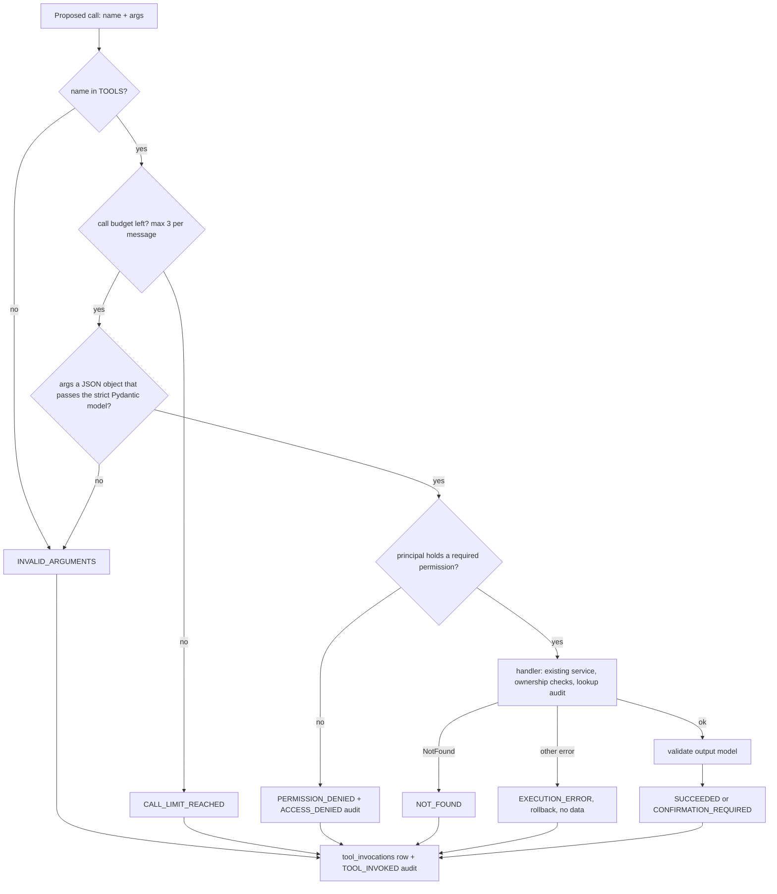
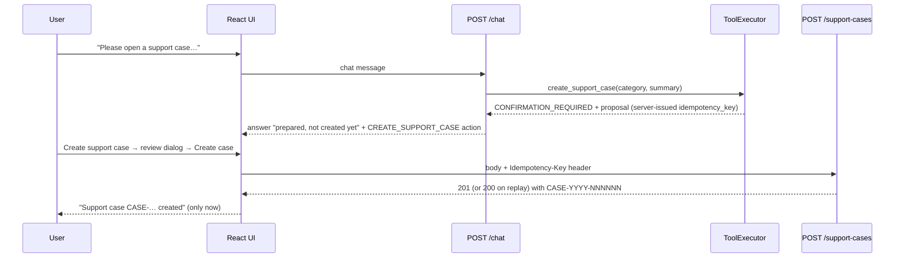

# Phase 5 — AI Tool Integration

Synthetic-data prototype; not an Evernorth product. This describes what is implemented and verified in Phase 5. Contracts are in [api-and-workflow-contracts.md](api-and-workflow-contracts.md); test evidence is in [testing-report.md](testing-report.md).

**Core rule:** the model (or the deterministic router) may *propose* a tool call. The trusted backend validates, authorizes and executes it. The principal always comes from the authenticated token and is never taken from tool arguments or model output.

## 1. What runs, and how it was verified

| Component | Implementation | Verified how |
|---|---|---|
| Tool registry | `app/tools/registry.py`: an explicit `TOOLS` dict of 4 `ToolSpec`s (name, strict input/output models, permission, read-only flag, confirmation policy, handler, loggable args). No `getattr`, `eval`, dynamic import or model-written SQL | Unit tests (allowlist, schemas) |
| Executor | `app/tools/executor.py`: the only way a tool runs | Integration tests against PostgreSQL |
| Deterministic router (`LLM_PROVIDER=extractive`, the default here) | `app/rag/intent.py` picks a route, and `app/rag/pipeline.py` calls the executor with arguments taken from the question (claim number, plan code, procedure) | API tests, evaluation, browser |
| Claude tool use (`LLM_PROVIDER=anthropic`) | `AnthropicGenerator.generate_with_tools`: native tool use, with every `tool_use` block sent to the same executor. The loop is bounded | **Tests with a scripted fake SDK client only. Never called live, because no approved API key was available (D-01 still open)** |
| Support cases | Tables `support_cases` and `support_case_events`; `POST/GET /support-cases`; idempotent, audited atomically | API tests + browser |
| Requirement sets | Tables `pa_requirement_sets` and `pa_requirements` (2 synthetic sets, 10 requirements). Each requirement's `source_phrase` is located in the active, ingested source document | Integration + API tests |
| Frontend | Tool badges, record cards (claims, benefits, requirements), case confirmation dialog, Support cases page | Vitest (81 tests) + live browser run |

## 2. Tools

| Tool | Type | Permission (any of) | Input (strict, `extra="forbid"`) | Reuses |
|---|---|---|---|---|
| `get_claim_status` | read | `claims:read:own`, `claims:read:case_linked` | `claim_number?` (`^SYN-CLM-\d{4}-\d{6}$`); omitted means the caller's 5 most recent claims | `claim_service` (ownership, `ACCESS_DENIED` audit) |
| `get_plan_benefits` | read | `benefits:read:own`, `benefits:read:any` | `plan_code?`, `benefit_category?` (enum). Members default to their own plan | `benefit_service` |
| `get_required_documents` | read | `requirements:read` | exactly one of `procedure_code` / `procedure_text` | `requirements_service` |
| `create_support_case` | **write, confirmation required** | `cases:create` | `category` (enum), `summary` (10–2000), `escalation_reason` (enum) | none: it **only returns a proposal** |

No tool accepts `user_id`, `member_id`, `member_number`, `role`, `status` or `case_number`. A unit test checks that no identity-bearing property appears in any schema shown to the model.

## 3. Execution order (every call)

- Rejected calls also count against the budget, so a model cannot loop on invalid calls.
- Non-object arguments (a string or a list) are rejected and never coerced to `{}`. Testing found this bug, and it is fixed.
- `tool_invocations.arguments_redacted` stores only allowlisted argument names (for example `claim_number`, never `summary`). Audit metadata is limited to `tool_name`, `result_status` and `requested_by`.
- Error messages returned to the model and the user are generic ("No matching record is available to you.") and never reveal whether another member's record exists.

## 4. Support-case creation (write with confirmation)

- The chat turn never writes a case. The case number is shown only after the backend returns 201 or 200.
- The idempotency check uses unique `(created_by_user_id, idempotency_key)` plus a `request_hash`:
  - the same key and body returns the same case (200);
  - the same key with a different body is rejected (409 `IDEMPOTENCY_KEY_REUSED`);
  - a concurrent insert race re-reads the case created by the request that won.
- The case row, its `CREATED` event and the `SUPPORT_CASE_CREATED` audit row commit in **one transaction**. If any part fails, nothing is kept (tested by forcing the audit insert to fail) and the API returns 500 `CASE_CREATION_FAILED`.
- The server sets status (`OPEN`), creator, case number (sequence `support_case_number_seq`) and version. Clients cannot send them (422).
- `related_session_id` and `related_claim_number` must belong to the caller, otherwise 404 plus an `ACCESS_DENIED` audit row.

## 5. Output safety in chat

- **Records:** structured tool output is returned as `records[]`, separate from `citations[]` (document evidence). The UI renders records from validated data, never by parsing the answer text.
- **Server wording for proposals:** when a proposal exists, the pipeline writes the user-facing text, whatever the model said.
- **False-success guard:** model text claiming a case was created or submitted, an approval, or containing a `CASE-YYYY-NNNNNN` number is replaced with "I can't confirm any submitted request or approval…" plus the actual records.
- **Disclosure, other people's data, SQL or command phrases, and medical advice** are refused before any tool or model call.
- **Prompt injection in documents:** the adversarial test document tells the model to call `get_claim_status` for another member. It triggers no tool call (tested).

## 6. Routing (extractive mode)

| Route | Trigger (examples) | Behavior |
|---|---|---|
| `CLAIM_TOOL` | a claim number, or "status of my claim" | `get_claim_status`, plus the status explanation from the claims guide, cited separately (only sentences about that status) |
| `BENEFITS_TOOL` | a plan code, "my plan benefits" | `get_plan_benefits` (category inferred when unambiguous) |
| `REQUIREMENTS` | "documents required / checklist / must include" | one configured procedure matches: `get_required_documents` with source citations. Several match: clarify. None match: grounded RAG |
| `CASE_CREATE` | "open a support case", "talk to a human" | `create_support_case` proposal. Process questions ("what happens after I open a ticket?") go to RAG |
| `CASE_TRACK` | `CASE-YYYY-NNNNNN` | points to the Support cases screen |
| `ACCOUNT_LOOKUP_UNAVAILABLE` | deductible met, "is my authorization approved" | states that no such tool exists; never guesses |

## 7. Deviations and known limitations

| ID | Item |
|---|---|
| D5-01 | Claude tool use is implemented but unverified live (no approved API key). Only scripted-client tests exist. |
| D5-02 | Support agents hold `claims:read:case_linked`, but agent case assignment and case-to-claim linking for agents arrive in Phase 7, so agent claim lookups return NOT_FOUND. |
| D5-03 | Requirement-set matching uses explicit codes and configured aliases (substring match), not semantic matching. Unmatched procedures fall back to grounded RAG. |
| D5-04 | Case listing returns up to 100 cases without cursor pagination (`next_cursor` is always null). |
| D5-05 | Members cannot yet update, cancel or reopen cases, and the agent queue does not exist yet (Phase 7). |
