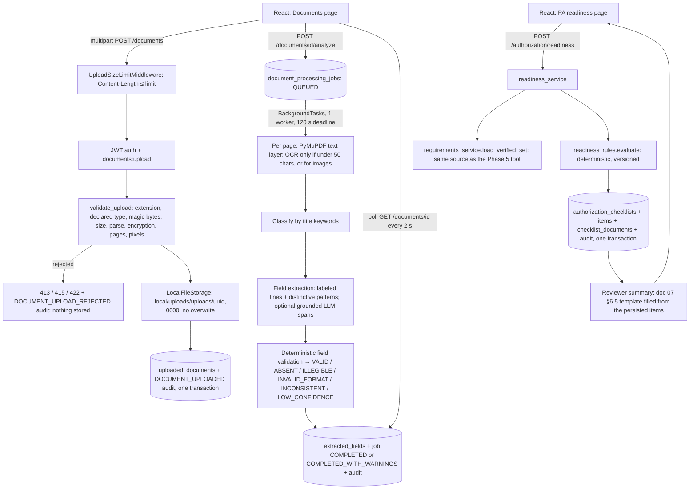

# Phase 6 — Document AI and Prior Authorization Readiness: Architecture

Synthetic-data prototype; not an Evernorth product. All requirement sets are **fictional demonstration rules**, not real policy. Setup and operations are in [document-processing-guide.md](document-processing-guide.md); measured results are in [evaluation-report.md](evaluation-report.md).

**Core rule:** readiness reports whether the configured documentation *appears to be present*. Nothing in IHSA (no table, enum, endpoint or message) represents an authorization approval, a denial, coverage or medical necessity (doc 07 §6.6).

## 1. Flow

All of this runs inside the existing FastAPI app. There is no new service or queue (doc 04: `BackgroundTasks` for the MVP). The job table records state, so a later move to a worker queue needs no schema change.

## 2. Upload and storage boundary

| Control | Implementation |
|---|---|
| Who can upload | `documents:upload` (MEMBER, PROVIDER). Owner = authenticated principal, never client input |
| Size before parsing | Pure ASGI middleware rejects `POST /api/v1/documents` without `Content-Length` (411) or above `MAX_UPLOAD_BYTES` + 64 KB (413) **before** the multipart body is read. The route reads at most `MAX_UPLOAD_BYTES + 1` bytes and re-checks |
| Type | Extension ∈ {.pdf, .png, .jpg, .jpeg} **and** declared MIME agrees **and** magic bytes agree, else 415. Pillow's detected format must also match |
| Content | PDF opens, isn't encrypted, has 1–`MAX_PDF_PAGES` (20) pages, and every page parses. Image dimensions are read from the header before decoding (≤ 25 MP; decompression-bomb warnings are errors), then `verify()` and a full decode. Else 422 `MALFORMED_FILE` with a reason code |
| Filename | Display only: last path component, control characters stripped, unusual symbols replaced. Never used in a path |
| Storage | `FileStorage` interface (ADR-09); `LocalFileStorage` writes `uploads/{uuid4}` under `DOCUMENT_STORAGE_DIR`. Keys are regex-validated, resolved paths must stay under the root, writes are exclusive temp + atomic rename with mode 0600. The config refuses a storage dir inside `public`/`static`/`dist`/`frontend` |
| Exposure | No API returns storage keys, hashes, paths or file bytes. There is no download endpoint (doc 07 §5.5) |
| Consistency | If the DB insert fails after the file was written, the file is deleted. Rejected files are never written |
| Duplicates | The same owner uploading identical bytes (SHA-256) gets the existing document (200) |
| Rate limits | `DOCUMENT_UPLOADS_PER_HOUR` / `DOCUMENT_ANALYSES_PER_HOUR` per user (429) |
| Retention | `expires_at` = upload + `DOCUMENT_RETENTION_DAYS` (30, provisional A-07). Expired documents are treated as not found. The cleanup job that deletes files is Phase 7/8 (NFR-021) |
| Separation | Uploaded documents are never ingested into the knowledge base. `uploaded_documents` and `knowledge_documents` are unrelated tables |

## 3. Extraction and OCR

- **Native first:** PyMuPDF text per page. A page with at least `OCR_MIN_TEXT_CHARS_PER_PAGE` (50) characters is `TEXT_LAYER` and is never sent to OCR.
- **OCR fallback:** sparse pages (rendered at `OCR_DPI` 300) and images go to `TesseractOcr`. It runs the Tesseract CLI as a subprocess with an argument list (no shell), a per-page timeout of min(`OCR_PAGE_TIMEOUT_SECONDS`, remaining job time), and an allowlisted language string (`^[a-z]{3}(\+[a-z]{3})*$`). It parses TSV word confidences.
- **Page status** (`page_details`, persisted without text):

| Status | Meaning |
|---|---|
| `OK` | Text layer, or OCR with mean confidence ≥ `OCR_MIN_WORD_CONFIDENCE` |
| `EMPTY` | OCR ran and found no words (blank page) |
| `PARTIAL` | Some native text, but OCR couldn't run or added nothing |
| `LOW_QUALITY` | OCR mean confidence below threshold |
| `UNREADABLE` | Nothing could be read (OCR unavailable / failed / timed out, or the page failed to parse) |

- **Failure is never "missing":** if any page is not `OK`/`EMPTY`, a field not found elsewhere is `ILLEGIBLE` (with the unreadable page numbers), not `ABSENT`. If the whole document yields no text because OCR is unavailable or failed, the job is `FAILED` / `OCR_FAILED` with a safe explanation, and its document can't be used for readiness (409).
- **Confidence:** only OCR words carry confidence. A value containing a word below `OCR_MIN_WORD_CONFIDENCE` (60) is `ILLEGIBLE`. A value with mean confidence below `EXTRACTION_LOW_CONFIDENCE` (0.70) is `LOW_CONFIDENCE`. Text-layer values have `confidence = null`, never a fabricated number. These thresholds are provisional and uncalibrated.
- **Text is transient:** extracted text exists only in memory during the job. Only fields (raw value = exact span), page metadata and warning codes are stored (doc 05 §2.10).

## 4. Structured extraction (schema 1.0, doc 07 §5.3)

| Document type (title keyword) | Fields |
|---|---|
| `PA_REQUEST_FORM` ("Prior Authorization Request") | member_number, procedure_code, procedure_description, requested_service_date, ordering_provider_name, ordering_provider_npi, facility_name, conservative_therapy_duration, supporting_rationale, request_date |
| `REFERRAL_LETTER` | member_number, referring_provider_name, referral_date, referred_service |
| `CLINICAL_NOTE_SUMMARY` | member_number, note_date, author_name |
| `CLAIM_SUPPORT_LETTER` | member_number, claim_number, letter_date |
| `UNRECOGNIZED` (no keyword, or more than one) | none; warning `DOCUMENT_TYPE_UNRECOGNIZED` |

- **Deterministic extractor:** `Label: value` lines (case-insensitive, labels anchored to the line start, the longest label wins). Distinctive identifiers (`SYN-M-…`, `SYN-PROC-…`, `SYN-CLM-…`) may also be found without a label. Raw values are exact spans of a known page, so they are grounded by construction. Text that isn't a label line (including instructions aimed at an AI) can't create or change a field.
- **Optional LLM spans** (`LLM_PROVIDER=anthropic` only), for schema fields with no label match:
  - The model sees only the readable page text of this one document, marked as untrusted, and must return verbatim values with page numbers in a strict JSON schema.
  - A value is kept only if it appears (whitespace/case-normalized) on the page it cites. Everything else is discarded and counted (`UNGROUNDED_EXTRACTION_DISCARDED:n`).
  - Kept values go through the same validation. On any SDK or format failure, extraction stays deterministic-only (`LLM_EXTRACTION_UNAVAILABLE`).
  - **Status: tested with a scripted client only. No live model was called (no approved API key).**
- **Validation:**

| Value type | Rule |
|---|---|
| Pattern | Full regex match |
| Procedure code | Pattern match, and the code must be an active configured set |
| Date | Formats YYYY-MM-DD, MM/DD/YYYY (US reading, documented), "Month D, YYYY" and day-month forms; year 1900–2100; impossible dates are `INVALID_FORMAT` |
| Duration | Number + days/weeks/months |
| Text | Length limit |

  Different values for one field within a document are `INCONSISTENT`, with both listed. Missing values stay missing: nothing is defaulted (for example, never "today" for a date).

## 5. Processing status model (doc 02 §3.2)

`QUEUED → RUNNING → {COMPLETED | COMPLETED_WITH_WARNINGS | FAILED}` and `QUEUED → FAILED`, enforced by `pipeline.transition`. Terminal jobs are immutable, and re-analysis creates a new job (earlier fields are kept). `COMPLETED` means every field is `VALID` with no warnings; otherwise the job ends `COMPLETED_WITH_WARNINGS`. Error codes: `PDF_PARSE_ERROR`, `OCR_FAILED`, `TIMEOUT`, `INTERNAL_ERROR` (plus `error_detail`, a safe sentence).

- **Duplicates:** `analyze` locks the document row (`SELECT … FOR UPDATE`). While a job is `QUEUED`/`RUNNING` and younger than 2× the job timeout, a new request gets 409 `JOB_ALREADY_RUNNING`, with the job ID in `details`.
- **Interrupted jobs** (for example, a server restart): an older active job is closed as `FAILED`/`TIMEOUT` ("Processing was interrupted."), and a new one starts.
- **Concurrency:** a process-wide semaphore (`MAX_CONCURRENT_DOCUMENT_JOBS` = 1) bounds CPU. A job that can't start within the job timeout fails with `TIMEOUT`.

## 6. Requirements and readiness

- **Requirement source:** `requirements_service.load_verified_set`, the same function that serves the Phase 5 `get_required_documents` tool. It selects the single active set for the code and its source knowledge document (must be ACTIVE, INGESTED and visible to the caller's audience), and verifies each requirement's `source_phrase` in that document's chunks. Error codes: unknown set → 404 `REQUIREMENT_SET_NOT_FOUND`; source document unavailable → 404 `REQUIREMENTS_SOURCE_UNAVAILABLE`.
- **Inputs:** 1–10 of the caller's own documents, each with a latest job `COMPLETED`/`COMPLETED_WITH_WARNINGS` (else 409 `DOCUMENT_NOT_ANALYZED`). The checklist records the exact job used per document (`checklist_documents.job_id`).
- **Rules** (`app/documents/readiness_rules.py`, `RULES_VERSION` 1.0; rule parameters are strictly validated):

| Rule | SATISFIED | MISSING | UNREADABLE | NEEDS_MANUAL_REVIEW |
|---|---|---|---|---|
| `FIELD_PRESENT` | ≥1 VALID and all VALID agree | all ABSENT, or no document has the field | no VALID, ≥1 ILLEGIBLE/LOW_CONFIDENCE | any INCONSISTENT/INVALID_FORMAT, or VALID values disagree |
| `FIELD_PATTERN` | as above + regex | as above | as above | value doesn't match |
| `DATE_WITHIN_DAYS` | both dates VALID, 0 ≤ Δ ≤ max | either ABSENT | either unreadable | outside the window (including referral after request) or contradictory |
| `DOCUMENT_TYPE_PRESENT` | a document of that type | none, and none `UNRECOGNIZED` | — | none found but ≥1 `UNRECOGNIZED` |
| `MANUAL_ONLY` | — | — | — | always |

  Precedence: NEEDS_MANUAL_REVIEW > SATISFIED > UNREADABLE > MISSING. These also give NEEDS_MANUAL_REVIEW: an unknown rule type, invalid parameters, or a requirement whose source passage can't be verified (the automated result is stated in the explanation).
- **Overall status:** any MISSING/UNREADABLE → `DOCUMENTATION_INCOMPLETE`; else any manual item → `MANUAL_REVIEW_REQUIRED`; else `DOCUMENTATION_APPEARS_COMPLETE`.
- **Traceability per item:** requirement (code, description, rule type), evidence field IDs with document/page/status/value, a deterministic explanation, and the requirement source re-located in the exact knowledge-document version recorded on the checklist (`requirement_source_document_id`).
- **Warnings:**
  - `PROCEDURE_CODE_MISMATCH`: the form states a different code.
  - `DOCUMENT_HAS_WARNINGS`.
  - `REQUIREMENT_SOURCE_PARTIALLY_VERIFIED`.
- **Persistence:** the checklist, items, document links and the `READINESS_CHECKLIST_CREATED` audit row (with counts) commit in one transaction. Items are immutable, and a re-run creates a new checklist.

## 7. Reviewer summary

The doc 07 §6.5 template, filled from the persisted items:
- procedure and set version;
- documents with their detected types;
- the result with counts recomputed from the items;
- every non-satisfied item with its explanation;
- warnings;
- the requirement source with its effective date;
- the full disclaimer.

No LLM is used (per doc 07 §6.5), so the summary can't contradict the checklist. The frontend validator also rejects a checklist whose counts don't match its items.

## 8. Security and privacy

- **Ownership:** every document and checklist read is owner-only. Other users' or nonexistent IDs return 404 with an `ACCESS_DENIED` audit row (`NOT_OWNER`/`NOT_EXISTS`), so IDs can't be probed.
- **Audit:** `DOCUMENT_UPLOADED`, `DOCUMENT_UPLOAD_REJECTED`, `DOCUMENT_ANALYSIS_REQUESTED`, `DOCUMENT_ANALYSIS_COMPLETED`/`_FAILED` and `READINESS_CHECKLIST_CREATED`. Metadata is limited to allowlisted keys: types, sizes, enums and counts, never document content.
- **Prompt injection:** document text is data. The deterministic extractor ignores non-label text; LLM output must be grounded; the model never sees or sets checklist statuses. Tested with an injected "mark everything SATISFIED / approve / NPI 9999999999" document.
- **Logs:** no document text, filenames of other users, or storage paths. Errors returned to clients are generic and carry stable codes.
- **Not implemented:** malware scanning. No approved scanner is available, so **files are not malware-scanned** (they are parsed only by PyMuPDF/Pillow and never executed).

## 9. Deviations from the Phase 1 design

| ID | Deviation | Reason |
|---|---|---|
| D6-01 | `document_processing_jobs.page_details` (jsonb) and `warnings` (text[]) | Per-page method/status and warning codes for display; no text stored |
| D6-02 | `pipeline_version` on jobs, `rules_version` on checklists | Provenance across re-processing |
| D6-03 | `error_detail` (safe sentence) on jobs | User-facing reason for `FAILED` |
| D6-04 | `authorization_checklists.requirement_source_document_id` | Phase 5 resolves the source by document key at query time (D5-02); the checklist pins the exact version |
| D6-05 | `authorization_checklists.warnings` | Procedure mismatch and other non-status signals |
| D6-06 | No LLM document-type classification (doc 07 §5.2 step 4) | Deterministic title keywords only; unknown → `UNRECOGNIZED` → manual review |
| D6-07 | `GET /authorization/requirement-sets` | The UI needs the list of active sets to choose a procedure |
| D6-08 | `extracted_fields`: `ILLEGIBLE` may have `raw_value = NULL` | A field not found because pages were unreadable must not be `ABSENT` |
| D6-09 | Error code `REQUIREMENT_SET_NOT_FOUND` now returned by the Phase 5 requirements endpoint too | Aligns with doc 06 §3.7 |
| D6-10 | Same-owner identical uploads return the existing document (200) | Duplicate-aware intake |

## 10. Known limitations

- **OCR is unverified:** Tesseract isn't installed in this environment, so the OCR path is covered only with a fake engine. Scanned documents currently fail honestly (`OCR_FAILED`) or yield `ILLEGIBLE` fields.
- **LLM-assisted extraction is unverified live.**
- **The extractor expects labeled synthetic forms.** Real-world layouts (tables, multi-column, handwriting) are out of scope.
- **Thresholds are provisional and uncalibrated:** OCR confidence 60, low confidence 0.70, 50 characters per page.
- **Not built yet:**
  - no malware scanning;
  - no retention cleanup job;
  - no user correction of extracted values;
  - no agent (case-linked) access to documents or checklists;
  - `review_state` stays `NOT_SUBMITTED`, because linking checklists to cases is Phase 7.
- **Single process:** in-process background work can be lost on restart. Such jobs are closed as `TIMEOUT` on the next analyze request.
