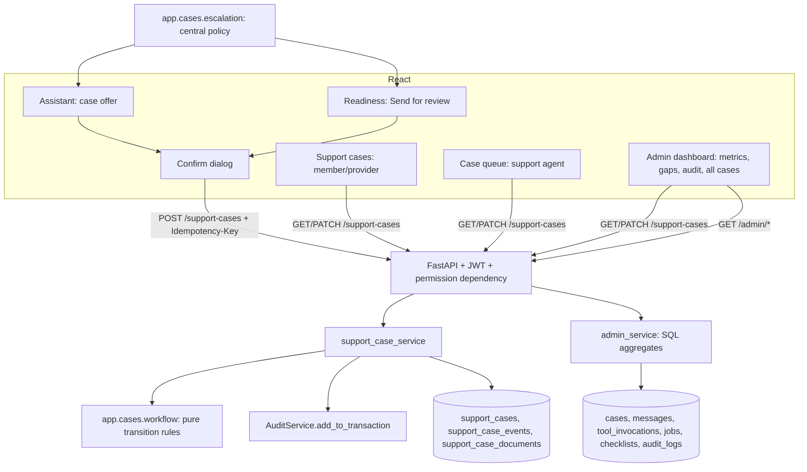

# Phase 7 — Escalation and Case Management

Synthetic-data prototype; not an Evernorth product. This extends the Phase 5 support-case system (same tables and the same `POST /support-cases`); there is no second case system. Source of truth: doc 02 §3.1 (lifecycle), Workflows E–F, doc 06 §3.8.

## 1. Architecture

Everything runs in the existing FastAPI app and PostgreSQL. No queues or new services were added.

## 2. Escalation policy (`app/cases/escalation.py`)

Every place that offers human help asks one module for the reason and category. **No case is ever created automatically.** Every condition produces an offer that the user confirms.

| Condition | Where detected | Reason | Category |
|---|---|---|---|
| No adequate answer | RAG evidence below threshold | `NO_ADEQUATE_ANSWER` | `KNOWLEDGE_GAP` |
| Sources conflict | Conflict detection | `CONFLICTING_INFORMATION` | `KNOWLEDGE_GAP` |
| Tool failed | Executor `EXECUTION_ERROR` | `TOOL_FAILURE` | `TECHNICAL_ISSUE` |
| User asks for a person / a case | Router | `USER_REQUESTED_HUMAN` | from the request (`create_support_case` proposal) |
| Readiness needs a reviewer | Checklist not `DOCUMENTATION_APPEARS_COMPLETE` and not yet submitted | `DOCUMENT_REQUIRES_REVIEW` | `PA_READINESS_REVIEW` |
| Medical or other out-of-scope questions | Router | `OUT_OF_SCOPE` | `OTHER` |

- **Case summary:** a short, minimized summary. For chat it is the user's question; for readiness it is the procedure code, status, counts and the requirement codes needing attention, never document values. Linked items are references (session, claim, checklist, document IDs), all checked to belong to the creator.
- **No priority:** there is no priority score or response-time promise, because Phase 1 defines none.
- **Honest outcomes:** the UI shows the case number only after 201/200. On failure it shows "Your support case was not created", and nothing exists (transaction rolled back). The status text always explains that `OPEN` means "Nobody has reviewed it yet".

## 3. Lifecycle (doc 02 §3.1, implemented in `app/cases/workflow.py`)

| From | To | Who | Requires |
|---|---|---|---|
| OPEN | ASSIGNED | agent ("Assign to me"), admin (assign) | target is an **active SUPPORT_AGENT** |
| OPEN | CANCELLED | creator, admin | admin: `reason` |
| ASSIGNED | IN_PROGRESS | assigned agent | — |
| ASSIGNED | OPEN | assigned agent (release), admin (unassign) | clears the assignee |
| ASSIGNED / IN_PROGRESS / AWAITING_USER | ASSIGNED (new agent) | admin (reassign) | active agent, different from current |
| IN_PROGRESS | AWAITING_USER | assigned agent | `note` (the question for the requester) |
| AWAITING_USER | IN_PROGRESS | assigned agent; **automatically when the creator adds a note** | — |
| IN_PROGRESS | RESOLVED | assigned agent | `resolution_note`; sets `resolved_at` |
| RESOLVED | IN_PROGRESS | creator (within 14 days of `resolved_at`), assigned agent | `note`; clears `resolved_at` |
| RESOLVED | CLOSED | assigned agent, admin | admin: `reason`; sets `closed_at` |
| any non-terminal | CANCELLED | admin | `reason` |

`CLOSED` and `CANCELLED` are terminal: no transitions and no notes. Notes (`NOTE_ADDED`) can be added by the creator or the assigned agent on non-terminal cases.

Answers to the Phase 7 design questions:
- **Can a closed case be reopened?** No. Only `RESOLVED` can be reopened, and only within 14 days.
- **Who can reassign?** Only an admin (`cases:assign:any`).
- **Can an unassigned case be resolved?** No, because it must be `IN_PROGRESS` with an assignee.
- **Can a member close their own case?** No. A member can only cancel while it is `OPEN`.
- **What about concurrent updates?** They are covered by optimistic locking (§5).

## 4. Visibility and scopes

| Caller | `GET /support-cases?scope=` | Detail view |
|---|---|---|
| Member / provider (`cases:read:own`) | `mine` (default) | **full** for own cases |
| Support agent (`cases:read:queue`, `cases:read:assigned`) | `queue` (OPEN and unassigned), `assigned` (assigned to me; default) | **summary** for queue cases; **full** for own assigned cases |
| Admin (`cases:read:metadata_all`) | `all` (default) | **summary** for every case |

- **Scope enforcement:** the scope is checked against the caller's permissions (403 otherwise), and the scope's own WHERE clause is always applied. Omitting a filter never widens access.
- **Not visible:** other cases return 404 plus `ACCESS_DENIED` (`NOT_EXISTS`/`NOT_OWNER`/`NOT_ASSIGNED`).
- **Full view adds:** linked documents, the related claim number and status, the linked checklist ID, and notes in history. The last 6 conversation messages (`conversation_excerpt`) are included for the **assigned agent only** (doc 06 §3.8).
- **Summary view hides** all linked content and every note.
- **Audit:** agent and admin views write `SUPPORT_CASE_VIEWED`.
- **Linked resources:** the assigned agent (and only while the case is not cancelled) may open the linked readiness checklist (`readiness:read:case_linked`) and linked documents' extracted fields (`documents:read:case_linked`). Each view is audited (`READINESS_CHECKLIST_VIEWED`, `DOCUMENT_VIEWED`). Other agents get 404.
- **Filters and paging:** `status` (multi), `category`, `case_number`, `created_from`/`created_to`, `limit` 1–100, and a keyset `cursor` over (`updated_at`, `id`) DESC. The order is stable, and no row is skipped or repeated between pages (tested).

## 5. `PATCH /support-cases/{case_id}`

Request: `{version, status?, note?, resolution_note?, assign_to_me?, release?, assigned_to_user_id?, unassign?, reason?}`. Unknown fields (for example `created_by_user_id`, `case_number`) → 422.

Processing:
1. Load the case `SELECT … FOR UPDATE`.
2. Check visibility (404 + audit if not visible).
3. Check the version.
4. Check field-level permissions (assignment fields need `cases:assign:any`; `assign_to_me` needs `cases:assign:self`).
5. Validate the assignee (exists, `SUPPORT_AGENT`, `ACTIVE`).
6. `workflow.apply`.
7. In **one transaction**: update the case (`version + 1`, timestamps), insert one `support_case_events` row per change, insert the matching audit rows, and sync the checklist `review_state`.
8. Commit, then return the fresh detail with `allowed_actions`.

| Error | Code |
|---|---|
| Stale `version` (double click, another agent) | 409 `VERSION_CONFLICT` (details: current version) |
| Transition not in the table | 409 `INVALID_STATUS_TRANSITION` (details `FROM -> TO`) |
| Role may not do this | 403 `FORBIDDEN` |
| Bad assignee | 422 `INVALID_ASSIGNEE` |
| Missing `note` / `resolution_note` / `reason`, reopen window expired, or no change | 422 `VALIDATION_ERROR` |
| Database failure | 500, nothing changed |

Every rejection writes `SUPPORT_CASE_UPDATE_REJECTED` (FAILURE, with the reason code) **and changes nothing**. A failed audit insert rolls back the case change too (tested).

**Checklist review state** (doc 02 §3.6): case created → `AWAITING_REVIEW`; IN_PROGRESS/AWAITING_USER → `UNDER_REVIEW`; RESOLVED/CLOSED → `REVIEW_COMPLETED` (this is **not** an approval); CANCELLED → `NOT_SUBMITTED`.

## 6. UI

- **Shared `CasePanel`** (members, providers, agents, admins): status with a plain-language meaning, escalation reason, requester, assignee, summary, resolution, linked items (full view only), and history. It shows only the buttons from `allowed_actions`. Each action opens a confirmation dialog that asks for the required note, resolution or reason, sends the version, and shows "Saved" only after the API returns. A 409 conflict is explained, and nothing is claimed.
- **Case queue** (agents): "Unassigned queue" and "Assigned to me" tabs, server-side filters, "Load more" via cursor, and an empty state.
- **Admin "Cases" tab:** `scope=all`, with assign (agent picker from `GET /admin/support-agents`), unassign, close and cancel (reason required).
- **Readiness:** "Send to a support agent for review" appears when the server includes `escalation_offer`. After creation the checklist shows its review state.

## 7. Deviations

| ID | Item |
|---|---|
| D7-01 | `escalation_offer` added to the checklist response (server-decided readiness escalation) |
| D7-02 | PATCH also accepts `unassign: true` (admin), because `assigned_to_user_id: null` can't be told apart from "not sent" in the validated schema |
| D7-03 | Unassign while IN_PROGRESS/AWAITING_USER isn't permitted; admins reassign instead (the doc 02 table lists unassign only from ASSIGNED) |
| D7-04 | `evidence_references` validation and the `document_ids` cited-in-session check (doc 06 §3.8) aren't implemented; documents must be owned by the creator |
| D7-05 | Admin views of linked checklists and documents aren't offered (summary only, doc 06 §3.8 "ADMIN / queue view") |
